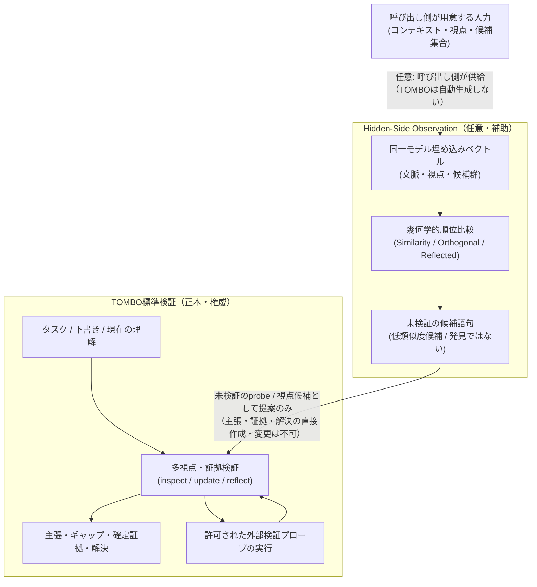
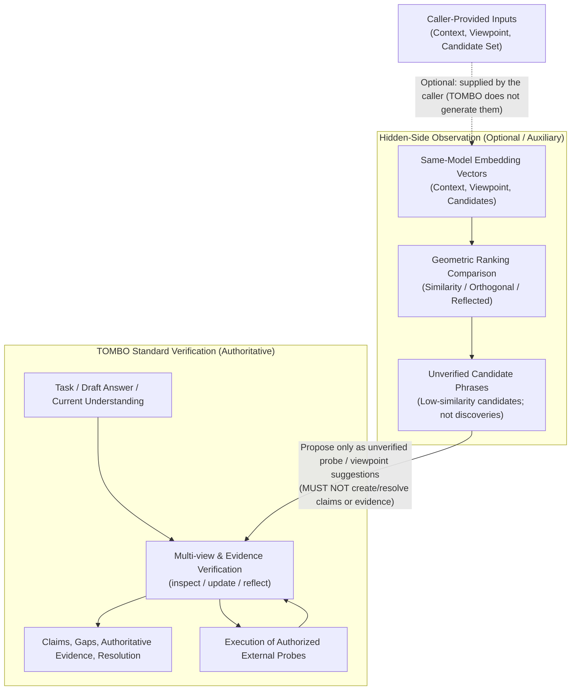

# TOMBO

AIが自分の理解を確かめる複眼ツール。回答案や操作予定を、主張、証拠、未確認事項、検査へ分け、追加証拠に応じて状態を更新します。

**v0.1 は探索的な試作品です。** TypeScript SDK、CLI、会話内スキルで、証拠に応じた状態更新と再考を実行します。4回の実モデル比較はいずれも受入条件を満たしていません。第4回は36試行中26試行が正常終了し、通常再点検は17/18、TOMBOは9/18でした。全件を別モデルで採点しましたが、採点者は同じOpenAI系列であり、異なるベンダーによる検証ではありません。比較終了後の修正を含む全494試験が親の環境で成功しました。修正後の効果は新規比較で未確認です。[最新の比較結果と限界](docs/metacognition-evaluation-epoch4.md)を参照してください。未知をすべて発見する能力、完全な理解、幻覚の防止を保証しません。

[English](#english) · [仕様書](TOMBO_spec_v0.1_ja.md) · [比較実験の準備](evaluation/README.md)

## 会話で使う

スキルの呼び出し名は `tombo-view` です。Codexでは `$tombo-view この回答の根拠と未確認の前提を点検して` と依頼します。`skills/tombo-view` をエージェントのスキル配置先へ入れると、会話中のAIが検査候補を作り、同梱の `scripts/session.mjs` がSDKで状態を検証します。追加のLLM APIキーや生成サービスは不要です。

固定デモに限定せず、許可された資料やコードを使って点検できます。利用者がJSONやアダプタを書く必要はありません。AIが入力、検査、証拠評価を用意します。SDKは参照や状態の整合性を確認しますが、AIの証拠評価の意味まで保証しません。

配置したスキルの `references/runtime.json` に `{ "repositoryRoot": "/absolute/path/to/tombo-view" }` を設定するか、`TOMBO_ROOT` でビルド済みSDKの場所を指定します。会話側の生成トークン数・費用は不明です。SDKのモデル呼び出し数はローカル提案適用の回数であり、会話全体の生成予算をSDKが制限したとは扱いません。

## 固定デモを動かす

Node.js 22以上とnpmを使います。npmへのパッケージ公開はまだ行っていません。

```sh
git clone https://github.com/nyattoh/tombo-view.git
cd tombo-view
npm ci
npm test
npm run demo
```

デモは、CLOSE 409の架空規約とイベント再送の架空テストを再生します。出力に `再生デモ / synthetic replay` を表示します。モデルは呼ばれず、検出能力の評価には使えません。

## CLIで状態を更新する

```sh
npm run build
node dist/cli.js inspect --input examples/account/task.json --adapter fixture --out results/state.json --ledger results/events.jsonl
node dist/cli.js update --state results/state.json --observations examples/account/observations.json --adapter fixture --out results/next.json --ledger results/events.jsonl
node dist/cli.js report --state results/next.json --format markdown --out results/report.md
node dist/cli.js replay --ledger results/events.jsonl --out results/restored.json
```

最初に検査候補を生成し、呼び出し元が実行した観測を `update` へ渡します。SDKやCLIは検索、シェル、通知、外部操作を暗黙に実行しません。`ready_for_requested_step` は指定範囲の必須確認が解決した判定であり、外部操作の許可ではありません。

`fixture` は二つの配布例だけに合致させます。任意の入力を調べるには、次の生成アダプタを用意してください。正常な意味上の判定は終了コード0、入力・モデル形式・実行基盤のエラーは1です。

## SDKを組み込む

```ts
import { createTombo, fixtureAdapter } from './dist/index.js';

const tombo = createTombo({ adapter: fixtureAdapter });
const first = await tombo.inspect(packet);
const observations = await host.runProbes(first.nextProbeIds);
const next = await tombo.update(first.state, observations);
const reopened = tombo.invalidate(next.state, {
	evidenceIds: ['e-account-result'],
	reason: '参照資料の版が更新された',
});
```

`packet` は `examples/account/task.json` の形式です。`host.runProbes` は呼び出し元が実装する関数です。スキーマと公開型はSDKからexportされます。証拠本文のUTF-8 SHA-256は `hashPassage` で作成できます。

開発版では `reflectionRequired: true` と `tombo.reflect(state, critic)` を使い、現在の理解を再考した記録がない状態を `needs_reflection` とします。criticは新しい観点・不足・検査の候補を作ります。批判だけで証拠や解決を追加できません。新しい証拠や候補で理解が変わると、古い再考記録は失効します。従来のTaskPacketは旧契約を維持し、過去のreadyを再考済みと読み替えません。

`runUnderstandingCheck({tombo, task, critic, executor})` は、この再考と明示した検査の実行を予算内で繰り返します。返却は `{status: 'completed', result}` または `{status: 'stopped', reason, result}` です。開始前の中断ではresultはnullです。実行の停止と理解状態を分け、完了はcompletedかつreadyの場合だけです。各executor呼び出しは一つの実検査を行い、実際の観測を返します。中断した観測を評価なしで保存する場合は `update(state, observations, {deferAssessment: true})` を使えます。

executorが不変な資料を保証できる場合は、観測の `staticSnapshot` に固定版の識別子を付けられます。同じ固定資料を再取得して情報と理解が変わらなければ、そのprobeを休止し、残る必要な検査へ進みます。実行できる検査がなければ `no_progress` で停止し、未知と未解決項目を保持します。現在の状態確認や機械検査には自動で適用しません。資料本文の「固定」「完全」などの語句から、不変性を推定しないでください。

CLIの再考は `node dist/cli.js reflect --state state.json --critic file:/absolute/path/critic.mjs --out reflected.json --ledger events.jsonl` で実行します。モジュールは `reflect(input)` を持つcriticを明示的にexportします。暗黙の提供者や有料生成接続は追加しません。

比較評価器は `evaluation/metacognition-runner.mjs`、実ホストへの入出力は `scripts/metacognition-host-trial.mjs` です。通常再点検との最初の同条件比較は不合格でした。機構の回帰テスト、開発用パイロット、評価用の成績は区別し、開発用の成功を効果実証としません。[比較結果](docs/metacognition-evaluation-epoch1.md)と[開発計画](docs/metacognition-plan.md)を参照してください。

`createTombo({ adapter })` に渡す生成アダプタは `generate(input)` を提供します。入力には `operation`、`task`、更新時の `state` と `observations`、出力トークン上限を含みます。応答は `proposal` と `usage` です。`proposal` は主張、観点、未確認事項、検査、証拠評価、解決の提案を含み、状態全体の上書きは受け付けません。

CLIは `--adapter file:/absolute/path/adapter.mjs` でESMモジュールのdefault exportまたは `adapter` exportを読みます。アダプタは信頼できるコードとして実行されます。提供者、鍵、料金、送信内容、通信の中断は呼び出し元が管理します。組込みの有料モデル接続はありません。公開型の `GenerationAdapter` と `GenerationOutput` を契約として使用してください。

`examples/http-adapter.mjs` は、上記の入出力契約に対応するHTTP生成サービスへ接続する例です。`.env.example` を `.env` へコピーし、許可した送信先と任意のBearer鍵を設定します。URLは特定プロバイダーのAPIではなく、TOMBOの提案JSONを返すサービスです。鍵をGitへ追加しないでください。

```sh
node --env-file=.env dist/cli.js inspect --input your-task.json --adapter file:examples/http-adapter.mjs --out results/state.json
```

接続例はHTTPSまたはローカルHTTPを受け付け、リダイレクトを拒否します。ローカルHTTPによる契約テストはありますが、実プロバイダーへの接続は未検証です。

金額上限を使う場合は、アダプタの `estimateMaxCostYen` で事前上限を示し、利用量を報告します。実際の生成とツール呼び出しの中断・上限予約もホストが保証します。未知の費用を0円として扱いません。

## 保存と再実行

- 各実行に一意の `executionId` を付けます。同じ実行結果の配送を再試行するときは同じIDを使います。別の実行は同じ結果でも別のIDです。
- 不正なモデル提案を修正する場合は、停止結果と同じ観測バッチ全体を再評価に渡します。追加のモデル適用とラウンドを計上し、実施済みの外部検査を二重計上しません。
- 修正前に保存された失敗状態には再評価バッチの情報がありません。その状態の回復は保証せず、新しいタスクとして点検を開始してください。旧状態と台帳は引き続き読めます。
- 証拠を撤回すると評価待ちのバッチを破棄し、必要な検査を再開します。実施済みの利用量は保持し、新しい検査には新しい実行IDと証拠IDを使います。
- `FileJournal.commit(expectedRevision, state)` が排他的に版を照合し、JSONLへ確定状態を追記します。JSONLを正本とし、状態JSONは再生成できるキャッシュです。
- `FileJournal.assertCurrent(state)` が入力状態を正本と照合します。CLIと会話用ヘルパーは、モデルを適用する前に版番号と状態の内容を確認します。確定時にも、目的・予算・能力などの固定タスク情報を維持します。
- 履歴は証拠本文を除去し、参照、ハッシュ、`passageUnavailable` を残します。再生はモデルを呼びません。再検証に必要な本文は呼び出し元が元の許可された資料から再取得します。
- 不完全な末尾や不一致のハッシュを持つ履歴は拒否します。中断後の `.lock` を自動削除しません。書込み中のプロセスがないことを確認し、原本を保全してから明示的に復旧します。
- 状態JSONには資料本文が含まれ得ます。資料、回答案、目的自体に秘密や個人情報を含めないでください。`results/` と `.env` はGitの対象外です。

## 確認できる動作と限界

テストは、証拠IDとハッシュ、適用範囲、支持と反証、結果なし、証拠撤回、配送の重複、利用量、予算、版競合、履歴再生、CLIの入出力を確認します。構造検証だけでは証拠の意味が正しいとは保証できません。

候補は最大8件、各回の検査は最大3件です。初期予算は追加探索2回、モデル呼び出し3回、ツール呼び出し6回、120秒です。上限は設計値で、性能の実測値ではありません。ホストの実行時間と利用量も予算に含めます。

比較準備用の48件は自作の架空ケースです。別の評価用６件で、注釈を参加モデルへ渡さず通常再点検とTOMBOを比較しました。ホスト経由の生成を実行しましたが、直接の有料API接続と効果の統計評価は行っていません。費用とトークン数は不明です。

## エージェント用スキル

`skills/tombo-view` ディレクトリ全体を利用するエージェントのスキル配置先へコピーし、上記のSDK配置設定を行います。会話内モードではAIが提案を作り、同梱ヘルパーが適用します。スキルを読むだけで検査成功を保証しません。

## Hidden-Side Observation（任意）

### 実用的利点と位置づけ

標準の多視点点検（inspect / update / reflect）を維持したまま、同一Embeddingモデルから得たコンテキスト・視点・候補のベクトルを用いて、通常の類似度（Similarity）検索では低順位に沈む候補語句を直交残差や反射視点によって浮上させます。これにより、通常の類似度順位では見落とされがちな死角や未探索の観点を洗い出し、**未検証のprobe（検査）や視点（viewpoint）の提案候補**としてTOMBOの標準検証ワークフローへ渡すことが実用上の利点です。

**境界と制限事項**:
- 浮上した候補語句は、あくまで未検証の提案に過ぎません。**主張（claim）や証拠（evidence）を直接作成・解決することはできず**、解決には既存のTOMBOによる正規の証拠検証（外部ソースの読み取り・実行結果の評価）が不可欠です。
- **順位が低いことや順位が変化したことは「発見」や「有用性」の証拠ではありません**。



図の補足: Hidden-Sideのベクトル検索へ渡すコンテキスト・視点・候補集合は、**すべて呼び出し側が用意して供給**します（本ライブラリはEmbeddingや候補集合を生成しません）。この任意ブランチが返すのは未検証の候補語句・probe/視点の提案だけであり、それらは標準の証拠検証（MultiView）にのみ戻されます。

### 幾何学的制約と解釈のガード (Geometry Guard)

単位視点ベクトル $v$、コンテキスト空間への射影 $p = P(v)$、直交残差 $r = v - p$ に対し、$\cos(r, v) = \|r\|$ および $\cos(p - r, v) = 2\|p\|^2 - 1$ が成り立ちます。
- 射影ノルム $\|p\| < 1/\sqrt{2}$（約0.707）のとき、反射ベクトル $p - r$ は現在の視点 $v$ と逆方向を向きます（内積が負）。
- 下記の実測値では反射コサインは約 -0.62 です。
- したがって、Reflected候補は「現視点との類似度が低い候補（低類似度候補）」として扱うべきであり、「未知の発見」とみなしてはなりません。

### 実Embedding実行記録（2026-10-16）と厳しい限界

> **限界（必ず確認してください）**: 1回限りの実行、合成コーパス、人手による関連性評価なし。有効性、一般化、発見能力の証拠ではありません。順位の変動は有用性の証拠ではありません。

- **実行条件**: OpenAI `text-embedding-3-small`、1リクエスト、33文字列（282トークン）、合成固定28候補コーパス（文脈:「犬、カレー、夕暮れ、帰宅」、視点:「家庭での食事」）。
- **測定値（この1回のみ）**:
  - コンテキスト面rank: 4、視点射影ノルム: 0.437、残差ノルム: 0.900。
  - Similarityとのtop-10重複: Orthogonal 10/10、Reflected 0/10、決定論的Random 3/10。
  - Reflected候補のSimilarity順位: 24, 18, 21, 23, 16, 15, 22, 19, 14, 26。
  - すべての候補は `unverified`（未検証）。
- **再構成不能という限界**: 上記の測定値はメタデータ・集計値の要約です。候補ごとのライブ順位は公開しておらず、このリポジトリだけでは正確な順位を独立に再構成・検証できません。
- **データの扱い**: 生の全結果はGit管理外のローカルな `.audit` データ（無視対象）であり公開しません。リポジトリ既存の固定文字n-gramフィクスチャ（`evaluation/hidden-side-example.json`）はこの実Embedding結果ではありません。設計・方法論、集計値の要約、限界については [設計・実験ノート](docs/hidden-side-observation.md) を参照してください（候補ごとの全記録は含みません）。

### CrossRAGとの比較

- **参照状況**: ローカルの `D:\develop\works\crossrag` はClaudeにより参照・確認されました。
- **スコア定義の違い**: CrossRAGのOrthogonalは混合スコア（帯域0.42 + 直交0.38 + 関連/一貫性0.20）であるのに対し、TOMBOは純粋な射影残差コサイン（pure projection-residual cosine）を用います。両スコアは同等ではなく、移植や直接比較はできません。
- **Wedge方式**: CrossRAGのWedgeは順序付き候補ペアを必要としますが、TOMBOの候補は単一語句であるため、TOMBOにおけるWedgeは未実装のままです。
- **未検証リソース**: ローカルの `D:\develop\works\crossrag-skill` は未検証（NOT verified）です。公開ミラーの存在はローカル内容の証拠にはなりません。

### 動作確認デモ

```sh
npm run hidden-side-demo
```

この固定例は28件の架空候補とローカル文字n-gram特徴ベクトルで、Similarity・Orthogonal・Reflected View・Random Baselineの各上位10件を比較します。数学と順位差の再現確認に限られ、意味Embeddingの品質やHidden-Sideの有効性は未検証です。

## 開発

```sh
npm run typecheck
npm test
npm run demo
```

CIはLinuxとWindowsでNode.js 22と24を対象にします。MITライセンスです。第三者のPDFや非公開会話は配布物に含めません。学術的な新規性は未確認です。

## English

### Use TOMBO in a conversation

The skill name is `tombo-view`. In Codex, invoke it with `$tombo-view`.

Install `skills/tombo-view` in your agent's skill directory and ask it to check the evidence and unverified assumptions in a draft answer. The current agent prepares proposals and performs authorised probes; `scripts/session.mjs` applies the SDK's state checks. You do not need an additional model API key or generation service, and you do not need to write JSON yourself.

Point the installed skill's `references/runtime.json` at the built repository with a `repositoryRoot` field, or set `TOMBO_ROOT`. The helper makes no additional API calls. Usage for the conversation's generation remains unknown. Its SDK model-call counter counts local proposal applications and does not enforce the whole conversation's token, time, or monetary budget. The SDK validates structure and references, not the semantic correctness of the agent's assessments.

TOMBO is an experimental tool for checking an AI agent's understanding. It separates draft answers and planned actions into claims, evidence, open questions, and probes. New evidence updates the external state of understanding.

Version 0.1 provides a TypeScript SDK, a CLI, an agent skill, two synthetic replay examples, and 48 synthetic scenarios for preparing comparisons. All four real-model comparisons failed the acceptance criteria. The fourth completed 26 of 36 trials without execution errors, with 17 of 18 for the general recheck and 9 of 18 for TOMBO. A different model assessed every trial, but the assessor belongs to the same OpenAI family. This is not verification by a different vendor. All 494 tests passed in the parent environment after subsequent fixes. Their effect remains unverified in a new comparison. See the [latest comparison and limitations](docs/metacognition-evaluation-epoch4.md). TOMBO does not guarantee complete understanding, discovery of every unknown, or prevention of hallucinations.

### Run the replay examples

Use Node.js 22 or later. Clone this repository, run `npm ci`, `npm test`, and `npm run demo`. The npm package has not been published. The examples use fixed fictional account rules and an event-redelivery test. They do not call a model or measure detection ability.

The CLI commands above inspect a task, apply observations, produce a Markdown report, and replay a journal. Select `fixture` explicitly for the bundled examples. For other tasks, supply `--adapter file:/absolute/path/adapter.mjs`.

### Integrate the SDK

Use `createTombo({ adapter })`, then `inspect(packet)`, `update(state, observations)`, and `invalidate(state, input)`. The host selects and runs tools. TOMBO does not select providers, search services, shells, or external actions implicitly. A ready decision is not permission to execute an external action.

The development version supports `reflectionRequired: true` and `tombo.reflect(state, critic)`. A strict task needs a completed review of its current understanding before it can be ready. Critics propose lenses, gaps and probes; criticism cannot become evidence or a resolution. New observations or candidates invalidate an older review. Existing packets retain the previous contract.

`runUnderstandingCheck({tombo, task, critic, executor})` runs reflection and explicit probes within the budget. Its result distinguishes `completed` from `stopped`; a pre-start cancellation returns no understanding state. Each executor call performs one probe. `update(state, observations, {deferAssessment: true})` records observations without generating an assessment. The CLI accepts an explicit critic module through `reflect --state state.json --critic file:/absolute/path/critic.mjs`.

An executor may declare `Observation.staticSnapshot` only when it can guarantee an immutable source version. Repeated reads that add no information retire that probe while other required checks continue. With no remaining executable check, TOMBO stops with `no_progress` and preserves unknowns and open gaps. Do not infer immutability from source wording or apply it automatically to current-status checks or mechanical tests.

The comparison harness and host driver separate regression tests, development pilots and evaluation results. A successful pilot is not evidence of general effectiveness. See the [development plan](docs/metacognition-plan.md).

### Hidden-Side Observation (optional)

#### Practical Benefit and Boundary

While retaining TOMBO's standard multi-view evidence verification (inspect / update / reflect), Hidden-Side uses same-model vectors for context, viewpoint, and candidates to surface candidate phrases that ordinary similarity search ranks low, using orthogonal residuals and reflected views. Its practical benefit is uncovering potential blind spots or unexamined angles to propose strictly as **unverified probe or viewpoint suggestions** back into standard TOMBO verification.

**Boundaries and Constraints**:
- Surfaced phrases are unverified suggestions only. **They must not create or resolve claims or evidence**. All claim resolution must proceed through authoritative TOMBO evidence checking against external sources.
- **A low rank or changed ranking is not a discovery and does not evidence usefulness**.



Diagram note: the context, viewpoint and candidate set fed to Hidden-Side's vector search are **all prepared and supplied by the caller** (this library produces neither embeddings nor candidate sets). This optional branch returns only unverified candidate phrases and probe/viewpoint suggestions, and they flow back solely into standard evidence verification (MultiView).

#### Geometry Guard

For a unit viewpoint vector $v$, projection $p = P(v)$, and residual $r = v - p$: $\cos(r, v) = \|r\|$ and $\cos(p - r, v) = 2\|p\|^2 - 1$.
- When the projection norm $\|p\| < 1/\sqrt{2}$ (~0.707), the reflected query $p - r$ points opposite the current viewpoint (negative cosine).
- In the measured run below, reflected cosine is approximately -0.62.
- Therefore, reflected candidates must be treated as low-similarity candidates relative to the current viewpoint, not discoveries.

#### Live Semantic Run Facts (2026-10-16) and Severe Limits

> **Limits (read first)**: One single run, synthetic corpus, no human relevance ratings. This is not evidence of efficacy, generalisation, or discovery. Changed ranking does not evidence usefulness.

- **Run setup**: OpenAI `text-embedding-3-small`, one request, 33 strings (282 tokens), synthetic fixed 28-candidate corpus (context: "dog, curry, dusk, return home", viewpoint: "family meal").
- **Measured values (this run only)**:
  - Context-surface rank 4, viewpoint projection norm 0.437, residual norm 0.900.
  - Top-10 overlap vs Similarity: Orthogonal 10/10, Reflected 0/10, deterministic Random 3/10.
  - Similarity ranks of Reflected candidates: 24, 18, 21, 23, 16, 15, 22, 19, 14, 26.
  - All candidates are `unverified`.
- **Not independently reconstructible**: The figures above are a summary of metadata and aggregates. Per-candidate live rankings are not published, so exact ranks cannot be independently reconstructed or verified from this repository.
- **Data handling**: The full raw result is ignored local `.audit` data (untracked by Git) and is not published. The existing tracked n-gram fixture (`evaluation/hidden-side-example.json`) is not this live semantic result. See the [design and experiment note](docs/hidden-side-observation.md) for the design and methodology, an aggregate summary, and limitations (it does not contain full per-candidate records).

#### Comparison with CrossRAG

- **Inspection**: Local `D:\develop\works\crossrag` was read by Claude.
- **Score definitions**: CrossRAG Orthogonal uses a blended score (0.42 band + 0.38 orthogonal + 0.20 relevance/coherence); TOMBO uses pure projection-residual cosine. The two scores are not equivalent and must not be ported or compared directly.
- **Wedge retrieval**: CrossRAG Wedge expects ordered candidate pairs, whereas TOMBO candidates are single phrases, so TOMBO Wedge remains unimplemented.
- **Unverified skills**: Local `D:\develop\works\crossrag-skill` was NOT verified; the existence of a public mirror is not evidence of local content.

#### Demonstration

Run `npm run hidden-side-demo` for a fixed 28-candidate synthetic corpus using a transparent local character n-gram feature vectoriser. This checks the calculation and ranking changes only; it is not a semantic-embedding or effectiveness result.

An adapter supplies `generate(input)` and returns a proposal plus usage. It proposes claims, lenses, gaps, probes, assessments, and resolutions rather than replacing the state. The public `GenerationAdapter` and `GenerationOutput` types define the contract. Explicit adapter modules run as trusted code. The host manages credentials, charges, data disclosure, cancellation, and tool execution.

`examples/http-adapter.mjs` connects to an authorised service that implements this proposal contract. It accepts HTTPS or local HTTP, refuses redirects, and reads its optional bearer credential from the environment. Copy `.env.example` to `.env`, configure the endpoint, and use the `--env-file` command above. Local HTTP contract tests exist; live-provider connectivity remains unverified.

### Preserve evidence and usage

Give every real execution a unique `executionId`. Reuse it for delivery retries, but use a new ID for another execution even when the result is identical. No search result is not evidence of absence. Withdrawn evidence reopens dependent gaps. Unknown costs remain unknown.

To repair an invalid model proposal, submit the stopped state and the complete original observation batch. The additional assessment consumes a model attempt and a round, while existing tool usage is counted only once. Partial or mixed batches are rejected. Successful deliveries remain idempotent.

Failed states saved before this fix lack the assessment batch information. Start a new task to check them again. Existing states and journals remain readable.

Withdrawing evidence discards a pending assessment batch and reopens required probes. Usage remains recorded. Use new execution and evidence IDs for a new probe run.

`FileJournal.assertCurrent(state)` checks the input against the authoritative redacted journal state before generation. Commit also preserves the fixed task snapshot inside the lock.

`FileJournal` owns atomic revision checks and append-only state events. The journal is authoritative; a JSON cache is replaceable. Journal events omit evidence passages and retain their references and hashes. Replay needs no model. The host must retrieve missing passages from authorised sources before rechecking them. Incomplete journals and stale locks require explicit recovery. State JSON may contain source passages, so keep sensitive material outside public files.

### Verification and limitations

Tests cover state invariants, usage, budgets, replay, concurrency conflicts, and actual CLI calls. Structural validation does not prove semantic correctness. Compare TOMBO with a general recheck using the same model, evidence, tools, and budgets. Keep evaluation annotations away from model inputs and use independent assessment. All four real-model comparisons failed readiness. Live HTTP-provider integration and statistical effectiveness remain unverified.

The agent skill is in `skills/tombo-view/SKILL.md`. Development checks are `npm run typecheck`, `npm test`, and `npm run demo`. CI targets Linux and Windows with Node.js 22 and 24. The project uses the MIT licence. No third-party PDF or private conversation is distributed. Academic novelty has not been established.
