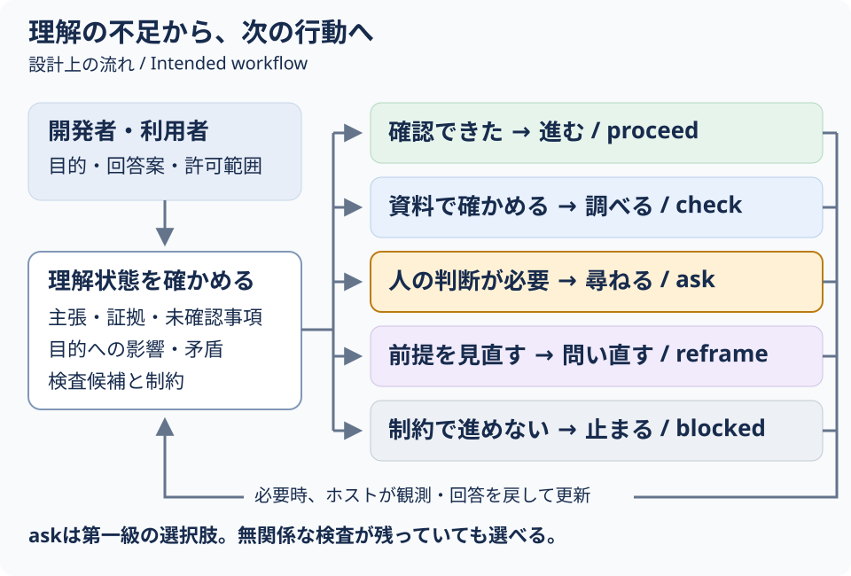
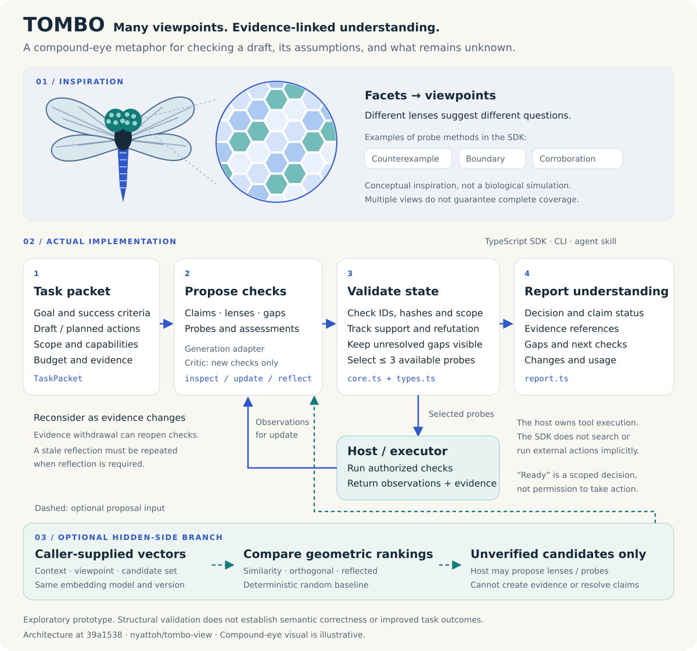
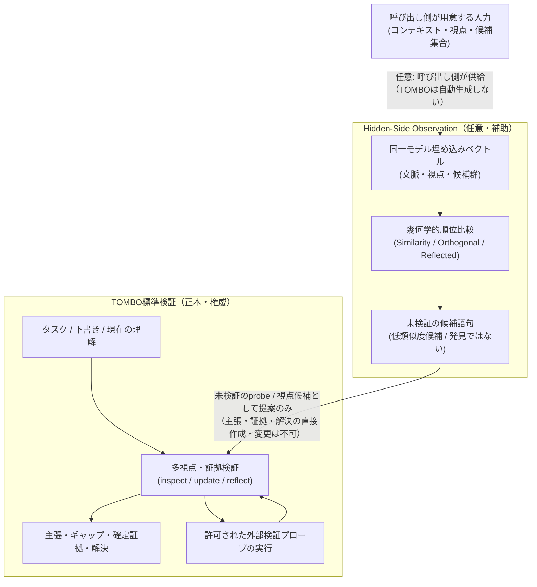
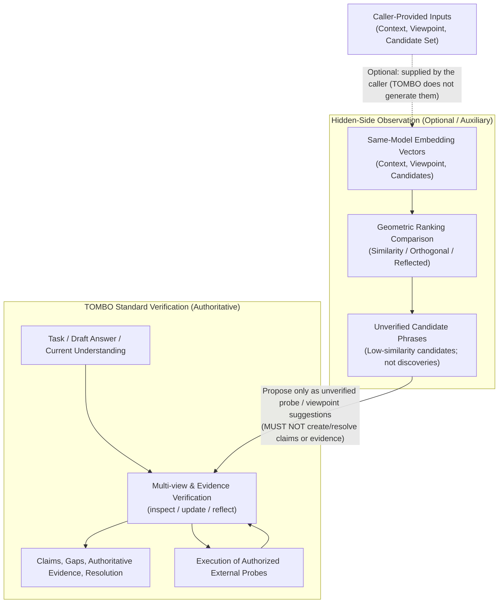

# TOMBO

AIが自分の理解を確かめる複眼ツール。**AIエージェントを開発・運用する人と、その回答や操作を確認する人**のために、回答案や操作予定を主張・証拠・未確認事項・検査へ分けます。「何を根拠に進めるか」「何を調べるか」「何を人に尋ねるか」を、理解状態に基づいて選びます。

**v0.1 は探索的な試作品です。** TypeScript SDK、CLI、会話内スキルを提供します。固定状態からの判断規則は検証していますが、ライブモデルの自発的な質問や、回答品質の改善効果は未実証です。

[English](#english) · [仕様書](TOMBO_spec_v0.1_ja.md) · [比較実験の準備](evaluation/README.md)

## 誰の何を解決するか

| 対象者 | 困っていること | TOMBOで扱えること |
| --- | --- | --- |
| AIエージェントの開発者・運用者 | 検査を続けているが、目的・優先順位・権限の不足が解消しない | 人だけが決められる不足を区別し、実行可能な検査が残っていても `ask` を選ぶ |
| 回答や操作を確認する利用者 | AIが何を根拠に進むのか、何を自分に確認したいのか分からない | 主張・証拠・未確認事項と、質問の理由・回答で確定する行動条件を確認する |
| エージェントを評価する人 | 自信や振り返りの文章だけでは、質問の必要性を比較しづらい | 同じ状態に対する判断を再現し、適切な質問・不要な質問・質問の見逃しを分けて数える |

例えば「速度と正確さのどちらを優先するか」が目的を変えるなら、人に尋ねます。資料で調べられる事実の不足なら検査し、前提の見直しが必要なら問い直します。質問数を増やすこと自体は目標にしません。

## 理解の不足から、次の行動へ



AIが候補を用意し、SDKが参照・状態の整合性と行動規則を検証します。`ask` は最後の手段ではなく、人の判断が必要なときに能動的に選ぶ行動です。実際の検査や質問の提示はホストが担当し、`proceed` は外部操作の許可を意味しません。「理解への関心」はこの行動上の狙いであり、主観的な関心や意識を測定したものではありません。

## 検証で分かったこと

### 固定状態でのask判断：必要な質問の見逃しを減らした

架空の60状態を、開発・自動化・研究の3ドメイン各20件で用意しました。入力と作者意図・期待値を分離し、OpenAI・Google・NVIDIAが各60件を独立に注釈しました。**全員一致42件だけ**を主指標に使い、不一致18件は未確定として分離しています。モデル注釈は暫定であり、客観的な正解ではありません。

| 指標（合意42件：ask 10件・非ask 32件） | 旧規則 `f2ecc2e` | ask-policy |
| --- | ---: | ---: |
| 必要なaskを選べた割合（recall） | 8/10（80%） | 10/10（100%） |
| 選んだaskが必要だった割合（precision） | 8/8（100%） | 10/10（100%） |
| 必要なaskの見逃し | 2件 | 0件 |
| 不要なask（合意が非askの32件） | 0件 | 0件 |
| 不要askの対照ケース違反（合意13件） | 0件 | 0件 |

これは**与えた固定状態から行動を選ぶ規則**の比較です。モデルが自ら不足や盲点を発見し、実際の会話で適切に質問できるようになったことまでは示しません。全60件の比較では行動が7件変わり、うち合意ケースは4件、不一致ケースは3件でした。[比較レポート](evaluation/reports/ask-policy-compare.json)、[暫定注釈](evaluation/ask-policy-annotations.json)、[不一致18件](evaluation/ask-policy-disagreements.json)、[評価方法と限界](evaluation/README.md)で確認できます。

ask-policy統合後の機構・回帰試験は**667/667成功**でした（2026-10-18、skip 0）。これはソフトウェアの検査結果であり、ライブモデルの有効性の証明とは分けます。[試験記録](docs/ask-policy-work/pm-integrated-test-r2-evidence.json)

### 実モデル比較：有効性はまだ示せていない

4回の実モデル比較はいずれも受入条件を満たしていません。第4回は36試行中26試行が正常終了し、通常再点検は17/18、TOMBOは9/18でした。全件を別モデルで採点しましたが、採点者は同じOpenAI系列であり、異なるベンダーによる検証ではありません。その比較終了後の修正時点では全494試験が親の環境で成功しましたが、修正後の効果は新規の実モデル比較で未確認です。[比較結果と限界](docs/metacognition-evaluation-epoch4.md)を参照してください。未知をすべて発見する能力、完全な理解、幻覚の防止を保証しません。

## アーキテクチャ



複眼は異なる視点から問いを立てる比喩です。SDKは主張・証拠・未確認事項を分け、状態の整合性を確認します。実際の検査や外部操作はホストが許可された範囲で実行します。

任意のHidden-Sideは、呼び出し側が与えたベクトルと候補集合の順位を比較します。候補は証拠そのものではなく、順位の違いや構造検査だけで正しさ・網羅性・効果を保証しません。図の細部は拡大してご覧ください。

## 会話で使う

スキル名は `tombo-view` です。Codexでは `$tombo-view このタスクの理解と根拠を確かめ、新しい情報を反映しながら進めて` と依頼できます。根拠や未確認の前提を見直す開発・通常会話の依頼でも、ホストの通常のskill選択対象になります。選択機構はホストに依存し、配置だけで常駐hookや全メッセージの傍受を保証しません。

起動したタスクでは、新証拠・反例・人の回答・訂正や追補に応じて理解を更新し、進む・調べる・尋ねる・問い直す・止まるを選びます。質問自体が目的ではありません。`needs_reflection` は現在の理解を再考するSDKの要求で、問い直しと同義ではありません。今回の限定的な合成forward試行では、実入力からの資料確認、不要な質問をしない進行、人の回答による更新、保存・再開に成功例がある一方、予算不足、誤った因果解釈、提案拒否などの失敗・部分成果も観測しました。D01では同じ目的の期限切れ追補を新taskへ移し、継続会計を失う失敗が残りました。[行動評価と限界](docs/understanding-skill-work/pr8-review-summary.md)を参照してください。一般的な性能改善やライブ効果は未実証です。

`skills/tombo-view` ディレクトリ全体をエージェントのスキル配置先へコピーし、配置した `references/runtime.json` に `{ "repositoryRoot": "/absolute/path/to/built/repository" }` を設定するか、`TOMBO_ROOT` でSDKの場所を指定します。配布元リポジトリ内のskillは相対位置でもSDKを見つけます。Node.js 22以上とビルド済み `dist/index.js` が必要です。AIはruntimeや権限の不足を説明し、無断でインストールや新API接続を行いません。

会話中のAI自身が実際の目的・回答案・資料から入力と提案を作り、許可された検査を行い、同梱の `scripts/session.mjs` がSDKで状態更新を検証します。固定デモに限定されず、利用者がJSONやアダプタを書く必要も、追加LLM APIキーや生成サービスもありません。SDKは参照と状態の整合性を検証し、証拠評価の意味を保証しません。[実行・追補・訂正・再開の手順](skills/tombo-view/references/host-session.md)を参照してください。

通常経路では、許可されたtaskの固定作業領域をcwdとし、skillの `scripts/session.mjs` を絶対パスで呼びます。保存許可に従い、SDK ledger/cacheとtask入力・提案・context・receipt・reportを、固定cwdの `.session/` 内に同居できます。深い準備より先に元の作業期限・開始根拠を扱い、得られなければ実toolの初回時計観測からの範囲を明示します。実根拠のclockを用意した初回activateの例は `--input .session/task.json --ledger .session/sdk.jsonl --out .session/state.json --task-clock .session/task-clock.json` です。原開始不明を遅いSDK開始で補いません。保存のためにcwdを変えたり許可外へ書いたりせず、具体的な管理予約名を避けます。statusで既存sessionを確認し、初回だけactivateしてtask・SDK ledger・state cacheを固定します。同じ目的の追補・人回答・反例はreceiveで受領し、同じsessionへのprepare/update/reflect/reportを使います。新TaskPacketや別ledgerで継続結果を作り直しません。資料更新で旧証拠の撤回が必要ならmanaged invalidateを使い、同taskの実観測updateと新しいreflectへ戻ります。期限後の撤回申告や評価せず破棄した観測は、評価済みと区別して保持します。新しい確認はreflectで新gap/probeの組を追加してから実観測をupdateします。人の回答用probeは初期提案で対応付け、希望や権限は `user_statement` として記録します。人の希望・許可を外的事実の根拠へ広げず、TOMBOのreadyから操作権限を推定しません。

再開は同じ保存作業領域のstatusから行います。SDK ledgerが理解・利用量・停止の正本、sessionイベントがidentity・未評価追補・遷移の正本で、cacheは交換可能です。生成不要の予算確認と封印した作業期限の検査をprepare時と適用直前（初回inspect前も含む）に行い、元budget・startedAt・usage・task clockを保持します。SDKのmaxElapsedMsは初回inspectからの区間で、準備を含む元の作業期限とは別です。追補・人待ち・取消や再開で時計を延長しません。同goalの予算・期限延長APIはなく、追加指示だけで評価再開できるとは案内しません。期限後もreceiveで追補を未評価保存できますが、旧readyを新情報まで評価済みとは扱いません。初回検査前の期限切れならstateはnullのままです。作業期限のsessionStopReasonとSDKの実stopReasonを分け、SDK予算切れを捏造しません。正当なgoal/successCriteria変更のtransitionは旧未知と実会計を残し、新予算を同一予算での継続と表示しません。redacted replayは現在の再検証ではありません。

これは保持されたbindingを使うhelperの管理経路です。未管理SDK/CLIの互換経路や、別workspace・記録の外部削除・SDK直接利用まで制御するOS sandboxではありません。保存権限・正本へのアクセスが必要で、期限検査はhelper呼出し境界であり、host処理の即時中断、常駐hookや全message interceptionは提供しません。会話の費用・総tokenはunknownであり、SDKのローカル提案適用回数は会話全体の生成・金額を制御しません。

このsession機構は受入2の観測失敗を対象とする追加実装であり、過去の失敗や監査を成功へ読み替えません。限定的な成功例を全受入達成や全試行の合格とは扱いません。現評価と限界は[行動評価記録](docs/understanding-skill-work/pr8-review-summary.md)を参照してください。

受入2の[E試行記録](docs/understanding-skill-work/pr8-review-summary.md)も保持しています。E01/E02は旧保存先制約のsourceを読んで起動を辞退した結果で、実activate CLIの拒否を観測したものではありません。E03は直接SDK経路を使い、記録されたtoken 300も未実測のためmanaged成功に数えません。保存先修正後の[F試行](docs/understanding-skill-work/pr8-review-summary.md)にはmanaged起動、期限後の同identity/会計保持、保存再開の限定的な成功例があります。一方、F01ではcaller申告の未来日時を実受領と扱い、F03は実managed commit後も元required gapが未解決でfresh reflectがなく、説明が根拠・保存状態を超える失敗/partialでした。これらの記録は保持しています。

[G試行の診断](docs/understanding-skill-work/pr8-review-summary.md)では、人回答を元gapへ対応付けた解決と訂正後の問い直しに限定的な成功がありました。一方、G01には未来のcaller日時・同goalの予算延長を示唆する説明、G03にはfresh reflect後も未測定の結論を支持し断定する失敗があり、準備時間と元の全体期限のずれも観測しました。F/Gの失敗記録を現在の修正で成功へ読み替えません。

現機構は、日時不明の新receiptではsource.receivedAtを省略でき、指定時はtimezone付きISOとhelper受理時刻+5000ms以内を検査します。helperReceivedAtはoutput-onlyのローカルOS受理時刻で、caller申告・証拠のretrievedAt・host配達時刻とは別です。旧receiptを補正せず、申告日時の真正も保証しません。任意のtask clockは作業全体の期限を別管理しますが、first_observed以前の未知の開始範囲を証明しません。

understandingStatusは現在の必須gap・再考・SDK段階完了の表示です。受領や新claimの支持だけを元gapの解決とせず、実回答を関連するclaim/gapと根拠あるresolutionへ対応付けます。引用が支持する範囲を超えた旧評価はlimitationsだけで済ませず実assessmentを訂正し、条件付き説明へ反映します。未完でも有用な提案は可能ですが、SDK段階完了は意味の正しさ・操作許可・goal全体の完了ではありません。一般性能や意味的解決能力の改善は未実証です。

[H評価](docs/understanding-skill-work/pr8-review-summary.md)は登録18turn／8threadの限定比較です。Codexは旧K4・改訂R9の両bundleで人回答更新・資料訂正・再考・限定付き説明を行いました。旧側にも成功があり、actor選択予算やモデル差もあるため、bundle単独の改善効果は示せません。Google両bundleの根拠を超える意味的主張は失敗として残り、訂正2runはquota不足で未完了です。H02の改訂Codexは初回ready後、元の全体期限を過ぎた追補を未評価保存し、fresh resumeでも同identity・会計・旧理解・停止を保持しました。Googleの初回費用上限0による停止は、十分な理解に達した成功ではありません。F1変更前のH試行時freezeの[PM統合npm r4](docs/understanding-skill-work/pr8-review-summary.md)は735/735でした。F1 r2を含む現在のfreezeでは[PM統合npm r6](docs/understanding-skill-work/pr8-review-summary.md)が767/767、exit0、fail・skip・cancel 0でした。いずれも決定論的回帰の結果であり、意味効果や受入達成の証拠ではありません。

登録比較後の正当な本人回答によるA4-r4とA3-r4は別の継続です。A4は実回答を反映して再考しましたが、旧gapのscope・対象claim対応の不備を残しmodel-call上限で停止した部分成果です。[PM source診断](docs/understanding-skill-work/pr8-review-summary.md)はSDK/runtimeの契約違反を示す証拠を認めていません。A3は期限後に本人回答を原文のまま配送し、同じchildのordinal4がcompletedとなりましたが、[保存状態](docs/understanding-skill-work/pr8-review-summary.md)は未評価受領・blockedで、回答の再評価完了ではありません。これら二つの実回答継続は登録18turnと分け、著者の期待回答や汚染とは扱いません。A3の古い質問1件は未回答のままです。Hの失敗・部分成果、過去の失敗・監査を保持し、全件成功・一般モデル有効性・受入2のPASSは主張しません。

F1の実装は、managed helperが実update/reflect提案拒否の安全なlastProposalRejectionを保存し、現在の失敗bindingと一致する次のprepareへ診断を渡す限定機構です。追加の自動model試行はなく、古い記録は非proposal revision後に現行診断として再利用せず、有効なupdate/reflectで除きます。記録済み証拠scope・execution・会計を改変せず、実試行の通常会計を維持します。既存claimless gapの救済（F3）でも意味効果の証明でもありません。[runtime実F1 GREEN](docs/understanding-skill-work/pr8-review-summary.md)は対象29/29、exit0、fail0、skip0（2026-10-21 05:43:35–05:43:49 JST）です。これはruntime担当の決定論的試験結果で、関連回帰・最終build/typecheck・全体freezeの完了を示しません。735/735は変更前baseline、現在のF1 r2を含む全npmは767/767でexit0でした。どちらも決定論的試験で、意味効果や受入2の達成を示しません。Hの全失敗・部分成果とAGENTSの未免責記録を保持し、F1の因果効果・受入2・full review・親監査PASSは主張しません。

## 固定デモを動かす

Node.js 22以上とnpmを使います。npmへのパッケージ公開はまだ行っていません。

```sh
git clone https://github.com/nyattoh/tombo-view.git
cd tombo-view
npm ci
npm test
npm run demo
```

デモは、CLOSE 409の架空規約とイベント再送の架空テストを再生します。出力に `再生デモ / synthetic replay` を表示します。モデルは呼ばれず、検出能力の評価には使えません。

## CLIで状態を更新する

```sh
npm run build
node dist/cli.js inspect --input examples/account/task.json --adapter fixture --out results/state.json --ledger results/events.jsonl
node dist/cli.js update --state results/state.json --observations examples/account/observations.json --adapter fixture --out results/next.json --ledger results/events.jsonl
node dist/cli.js report --state results/next.json --format markdown --out results/report.md
node dist/cli.js replay --ledger results/events.jsonl --out results/restored.json
```

最初に検査候補を生成し、呼び出し元が実行した観測を `update` へ渡します。SDKやCLIは検索、シェル、通知、外部操作を暗黙に実行しません。`ready_for_requested_step` は指定範囲の必須確認が解決した判定であり、外部操作の許可ではありません。

`fixture` は二つの配布例だけに合致させます。任意の入力を調べるには、次の生成アダプタを用意してください。正常な意味上の判定は終了コード0、入力・モデル形式・実行基盤のエラーは1です。

## SDKを組み込む

```ts
import { createTombo, fixtureAdapter } from './dist/index.js';

const tombo = createTombo({ adapter: fixtureAdapter });
const first = await tombo.inspect(packet);
const observations = await host.runProbes(first.nextProbeIds);
const next = await tombo.update(first.state, observations);
const reopened = tombo.invalidate(next.state, {
	evidenceIds: ['e-account-result'],
	reason: '参照資料の版が更新された',
});
```

`packet` は `examples/account/task.json` の形式です。`host.runProbes` は呼び出し元が実装する関数です。スキーマと公開型はSDKからexportされます。証拠本文のUTF-8 SHA-256は `hashPassage` で作成できます。

開発版では `reflectionRequired: true` と `tombo.reflect(state, critic)` を使い、現在の理解を再考した記録がない状態を `needs_reflection` とします。criticは新しい観点・不足・検査の候補を作ります。批判だけで証拠や解決を追加できません。新しい証拠や候補で理解が変わると、古い再考記録は失効します。従来のTaskPacketは旧契約を維持し、過去のreadyを再考済みと読み替えません。

`runUnderstandingCheck({tombo, task, critic, executor})` は、この再考と明示した検査の実行を予算内で繰り返します。返却は `{status: 'completed', result}` または `{status: 'stopped', reason, result}` です。開始前の中断ではresultはnullです。実行の停止と理解状態を分け、完了はcompletedかつreadyの場合だけです。各executor呼び出しは一つの実検査を行い、実際の観測を返します。中断した観測を評価なしで保存する場合は `update(state, observations, {deferAssessment: true})` を使えます。

executorが不変な資料を保証できる場合は、観測の `staticSnapshot` に固定版の識別子を付けられます。同じ固定資料を再取得して情報と理解が変わらなければ、そのprobeを休止し、残る必要な検査へ進みます。実行できる検査がなければ `no_progress` で停止し、未知と未解決項目を保持します。現在の状態確認や機械検査には自動で適用しません。資料本文の「固定」「完全」などの語句から、不変性を推定しないでください。

CLIの再考は `node dist/cli.js reflect --state state.json --critic file:/absolute/path/critic.mjs --out reflected.json --ledger events.jsonl` で実行します。モジュールは `reflect(input)` を持つcriticを明示的にexportします。暗黙の提供者や有料生成接続は追加しません。

比較評価器は `evaluation/metacognition-runner.mjs`、実ホストへの入出力は `scripts/metacognition-host-trial.mjs` です。通常再点検との最初の同条件比較は不合格でした。機構の回帰テスト、開発用パイロット、評価用の成績は区別し、開発用の成功を効果実証としません。[比較結果](docs/metacognition-evaluation-epoch1.md)と[開発計画](docs/metacognition-plan.md)を参照してください。

`createTombo({ adapter })` に渡す生成アダプタは `generate(input)` を提供します。入力には `operation`、`task`、更新時の `state` と `observations`、出力トークン上限を含みます。応答は `proposal` と `usage` です。`proposal` は主張、観点、未確認事項、検査、証拠評価、解決の提案を含み、状態全体の上書きは受け付けません。

CLIは `--adapter file:/absolute/path/adapter.mjs` でESMモジュールのdefault exportまたは `adapter` exportを読みます。アダプタは信頼できるコードとして実行されます。提供者、鍵、料金、送信内容、通信の中断は呼び出し元が管理します。組込みの有料モデル接続はありません。公開型の `GenerationAdapter` と `GenerationOutput` を契約として使用してください。

`examples/http-adapter.mjs` は、上記の入出力契約に対応するHTTP生成サービスへ接続する例です。`.env.example` を `.env` へコピーし、許可した送信先と任意のBearer鍵を設定します。URLは特定プロバイダーのAPIではなく、TOMBOの提案JSONを返すサービスです。鍵をGitへ追加しないでください。

```sh
node --env-file=.env dist/cli.js inspect --input your-task.json --adapter file:examples/http-adapter.mjs --out results/state.json
```

接続例はHTTPSまたはローカルHTTPを受け付け、リダイレクトを拒否します。ローカルHTTPによる契約テストはありますが、実プロバイダーへの接続は未検証です。

金額上限を使う場合は、アダプタの `estimateMaxCostYen` で事前上限を示し、利用量を報告します。実際の生成とツール呼び出しの中断・上限予約もホストが保証します。未知の費用を0円として扱いません。

## 保存と再実行

- 各実行に一意の `executionId` を付けます。同じ実行結果の配送を再試行するときは同じIDを使います。別の実行は同じ結果でも別のIDです。
- 不正なモデル提案を修正する場合は、停止結果と同じ観測バッチ全体を再評価に渡します。追加のモデル適用とラウンドを計上し、実施済みの外部検査を二重計上しません。
- 修正前に保存された失敗状態には再評価バッチの情報がありません。その状態の回復は保証せず、新しいタスクとして点検を開始してください。旧状態と台帳は引き続き読めます。
- 証拠を撤回すると評価待ちのバッチを破棄し、必要な検査を再開します。実施済みの利用量は保持し、新しい検査には新しい実行IDと証拠IDを使います。
- `FileJournal.commit(expectedRevision, state)` が排他的に版を照合し、JSONLへ確定状態を追記します。JSONLを正本とし、状態JSONは再生成できるキャッシュです。
- `FileJournal.assertCurrent(state)` が入力状態を正本と照合します。CLIと会話用ヘルパーは、モデルを適用する前に版番号と状態の内容を確認します。確定時にも、目的・予算・能力などの固定タスク情報を維持します。
- 履歴は証拠本文を除去し、参照、ハッシュ、`passageUnavailable` を残します。再生はモデルを呼ばず、保存済み状態の復元であって現在の再検証ではありません。再検証に必要な本文は呼び出し元が元の許可された資料から再取得します。
- 不完全な末尾や不一致のハッシュを持つ履歴は拒否します。中断後の `.lock` を自動削除しません。書込み中のプロセスがないことを確認し、原本を保全してから明示的に復旧します。
- 状態JSONには資料本文が含まれ得ます。資料、回答案、目的自体に秘密や個人情報を含めないでください。`results/` と `.env` はGitの対象外です。

## 確認できる動作と限界

テストは、証拠IDとハッシュ、適用範囲、支持と反証、結果なし、証拠撤回、配送の重複、利用量、予算、版競合、履歴再生、CLIの入出力を確認します。構造検証だけでは証拠の意味が正しいとは保証できません。

候補は最大8件、各回の検査は最大3件です。`examples/account/task.json` の初期予算は追加探索2回、モデル呼び出し3回、ツール呼び出し6回、120秒です。この配布例の値を会話内タスクの固定デフォルトにせず、ホストの提案生成や質問回答待ちを含む実経過を初回に見積もります。上限は設計値で、性能の実測値ではありません。ホストの実行時間と利用量も予算に含めます。

比較準備用の48件は自作の架空ケースです。別の評価用６件で、注釈を参加モデルへ渡さず通常再点検とTOMBOを比較しました。ホスト経由の生成を実行しましたが、直接の有料API接続と効果の統計評価は行っていません。費用とトークン数は不明です。

## エージェント用スキル

`skills/tombo-view` ディレクトリ全体を利用するエージェントのスキル配置先へコピーし、上記のSDK配置設定を行います。会話内モードではAIが提案を作り、同梱ヘルパーが適用します。スキルを読むだけで検査成功を保証しません。

## Hidden-Side Observation（任意）

### 実用的利点と位置づけ

標準の多視点点検（inspect / update / reflect）を維持したまま、同一Embeddingモデルから得たコンテキスト・視点・候補のベクトルを用いて、通常の類似度（Similarity）検索では低順位に沈む候補語句を直交残差や反射視点によって浮上させます。これにより、通常の類似度順位では見落とされがちな死角や未探索の観点を洗い出し、**未検証のprobe（検査）や視点（viewpoint）の提案候補**としてTOMBOの標準検証ワークフローへ渡すことが実用上の利点です。

**境界と制限事項**:
- 浮上した候補語句は、あくまで未検証の提案に過ぎません。**主張（claim）や証拠（evidence）を直接作成・解決することはできず**、解決には既存のTOMBOによる正規の証拠検証（外部ソースの読み取り・実行結果の評価）が不可欠です。
- **順位が低いことや順位が変化したことは「発見」や「有用性」の証拠ではありません**。



図の補足: Hidden-Sideのベクトル検索へ渡すコンテキスト・視点・候補集合は、**すべて呼び出し側が用意して供給**します（本ライブラリはEmbeddingや候補集合を生成しません）。この任意ブランチが返すのは未検証の候補語句・probe/視点の提案だけであり、それらは標準の証拠検証（MultiView）にのみ戻されます。

### 幾何学的制約と解釈のガード (Geometry Guard)

単位視点ベクトル $v$、コンテキスト空間への射影 $p = P(v)$、直交残差 $r = v - p$ に対し、$\cos(r, v) = \|r\|$ および $\cos(p - r, v) = 2\|p\|^2 - 1$ が成り立ちます。
- 射影ノルム $\|p\| < 1/\sqrt{2}$（約0.707）のとき、反射ベクトル $p - r$ は現在の視点 $v$ と逆方向を向きます（内積が負）。
- 下記の実測値では反射コサインは約 -0.62 です。
- したがって、Reflected候補は「現視点との類似度が低い候補（低類似度候補）」として扱うべきであり、「未知の発見」とみなしてはなりません。

### 実Embedding実行記録（2026-10-16）と厳しい限界

> **限界（必ず確認してください）**: 1回限りの実行、合成コーパス、人手による関連性評価なし。有効性、一般化、発見能力の証拠ではありません。順位の変動は有用性の証拠ではありません。

- **実行条件**: OpenAI `text-embedding-3-small`、1リクエスト、33文字列（282トークン）、合成固定28候補コーパス（文脈:「犬、カレー、夕暮れ、帰宅」、視点:「家庭での食事」）。
- **測定値（この1回のみ）**:
  - コンテキスト面rank: 4、視点射影ノルム: 0.437、残差ノルム: 0.900。
  - Similarityとのtop-10重複: Orthogonal 10/10、Reflected 0/10、決定論的Random 3/10。
  - Reflected候補のSimilarity順位: 24, 18, 21, 23, 16, 15, 22, 19, 14, 26。
  - すべての候補は `unverified`（未検証）。
- **再構成不能という限界**: 上記の測定値はメタデータ・集計値の要約です。候補ごとのライブ順位は公開しておらず、このリポジトリだけでは正確な順位を独立に再構成・検証できません。
- **データの扱い**: 生の全結果はGit管理外のローカルな `.audit` データ（無視対象）であり公開しません。リポジトリ既存の固定文字n-gramフィクスチャ（`evaluation/hidden-side-example.json`）はこの実Embedding結果ではありません。設計・方法論、集計値の要約、限界については [設計・実験ノート](docs/hidden-side-observation.md) を参照してください（候補ごとの全記録は含みません）。

### CrossRAGとの比較

- **参照状況**: ローカルの `D:\develop\works\crossrag` はClaudeにより参照・確認されました。
- **スコア定義の違い**: CrossRAGのOrthogonalは混合スコア（帯域0.42 + 直交0.38 + 関連/一貫性0.20）であるのに対し、TOMBOは純粋な射影残差コサイン（pure projection-residual cosine）を用います。両スコアは同等ではなく、移植や直接比較はできません。
- **Wedge方式**: CrossRAGのWedgeは順序付き候補ペアを必要としますが、TOMBOの候補は単一語句であるため、TOMBOにおけるWedgeは未実装のままです。
- **未検証リソース**: ローカルの `D:\develop\works\crossrag-skill` は未検証（NOT verified）です。公開ミラーの存在はローカル内容の証拠にはなりません。

### 動作確認デモ

```sh
npm run hidden-side-demo
```

この固定例は28件の架空候補とローカル文字n-gram特徴ベクトルで、Similarity・Orthogonal・Reflected View・Random Baselineの各上位10件を比較します。数学と順位差の再現確認に限られ、意味Embeddingの品質やHidden-Sideの有効性は未検証です。

## 開発

```sh
npm run typecheck
npm test
npm run demo
```

CIはLinuxとWindowsでNode.js 22と24を対象にします。MITライセンスです。第三者のPDFや非公開会話は配布物に含めません。学術的な新規性は未確認です。

## English

### Who TOMBO is for

TOMBO is for people who build or operate AI agents, and people who need to check their answers or planned actions. It records claims, evidence, open questions and probes so the next action can depend on what is understood and what remains unresolved.

| Audience | Problem | What TOMBO supports |
| --- | --- | --- |
| Agent developers and operators | More checks cannot settle a missing goal, priority or permission | Distinguish human-only decisions and choose `ask` before exhausting unrelated executable probes |
| People checking an answer or action | The reason for proceeding or requesting clarification is unclear | Inspect evidence, unresolved issues, the reason for a question and the action conditions its answer would settle |
| Agent evaluators | Confidence statements alone do not show whether clarification is needed | Replay the same states and count appropriate asks, unnecessary asks and missed asks separately |


If the choice between speed and accuracy changes the goal, ask the person. If a fact can be checked in a source, investigate it. If the framing needs revision, reframe. Asking more questions is not itself the goal. The model supplies candidates; the SDK validates references, state consistency and action rules. The host presents questions and executes permitted checks. `proceed` does not grant permission for an external action. Concern for understanding describes the intended behaviour, not measured subjective interest or consciousness.

### What has been verified

The ask-policy comparison uses 60 fictional states across development, automation and research, with 20 per domain. Inputs, author intent and expected actions are separated. OpenAI, Google and NVIDIA each independently labelled all 60 cases. **Only the 42 unanimous cases** enter the main metrics; 18 disagreements remain unresolved. Model labels are provisional, not ground truth.

| Metric (42 unanimous cases: 10 ask, 32 non-ask) | Old rule `f2ecc2e` | Ask-policy |
| --- | ---: | ---: |
| Necessary asks selected (recall) | 8/10 (80%) | 10/10 (100%) |
| Selected asks that were necessary (precision) | 8/8 (100%) | 10/10 (100%) |
| Missed necessary asks | 2 | 0 |
| Unnecessary asks (32 unanimous non-ask cases) | 0 | 0 |
| Unnecessary-ask control violations (13 unanimous controls) | 0 | 0 |

This verifies deterministic rules on supplied states. It does not establish that a live model spontaneously discovers gaps or blind spots, or asks better questions in conversation. Seven of all 60 decisions changed: four unanimous cases and three disputed cases. See the [comparison report](evaluation/reports/ask-policy-compare.json), [provisional labels](evaluation/ask-policy-annotations.json), [18 disagreements](evaluation/ask-policy-disagreements.json) and [method and limitations](evaluation/README.md).

After ask-policy integration, **667/667 mechanism and regression tests passed**, with none skipped (18 October 2026; [test record](docs/ask-policy-work/pm-integrated-test-r2-evidence.json)). Software checks and live-model effectiveness are separate claims. All four earlier real-model comparisons failed their acceptance criteria; the fourth completed 17/18 general-recheck trials and 9/18 TOMBO trials. The [comparison and limitations](docs/metacognition-evaluation-epoch4.md) remain applicable.

### Use TOMBO in a conversation

The skill name is `tombo-view`. In Codex, use `$tombo-view Check your understanding and evidence for this task, and update it as new information arrives.` Development and ordinary conversation requests that need evidence or assumptions reviewed are also eligible for normal skill selection. Selection depends on the host; installation does not guarantee a resident hook or interception of every message.

Within an activated task, revisit understanding when new evidence, counterexamples, human answers, corrections or follow-up information arrive. Choose whether to proceed, check, ask, reframe or stop. Asking is one possible action, not the purpose. The SDK's `needs_reflection` requests reconsideration of the current understanding; it does not automatically mean reframe. The limited synthetic forward trials included successful examples of checking supplied inputs, proceeding without unnecessary questions, updating from human answers, and saving and resuming state. Failures and partial outcomes were also observed, including insufficient budgets, mistaken causal interpretations and rejected proposals. In D01, an expired follow-up for the same goal was moved into a new task, losing continuity of accounting. See the [behavioural evaluation and limitations](docs/understanding-skill-work/pr8-review-summary.md). General performance improvements and live efficacy remain unproven.

Copy the whole `skills/tombo-view` directory into your agent's skill directory. Set its `references/runtime.json` to `{ "repositoryRoot": "/absolute/path/to/built/repository" }`, or set `TOMBO_ROOT`. A skill within this repository can also locate the SDK by its relative position. Node.js 22 or later and a built `dist/index.js` are required. If the runtime or permissions are missing, the agent explains the missing prerequisites rather than installing software or adding an API connection without authorisation.

The current agent prepares inputs and proposals from the actual task, performs authorised checks and uses `scripts/session.mjs` to apply SDK state validation. You need neither an additional model API key or generation service nor manually written JSON or an adapter. The SDK validates references and state consistency, not the semantic correctness of assessments. See the [execution, continuation, correction and resumption guide](skills/tombo-view/references/host-session.md).

For normal use, keep a fixed, permitted task workspace as the working directory and invoke the skill's `scripts/session.mjs` by its absolute path. Subject to the user's storage permission, the SDK ledger/cache, task inputs, proposals, contexts, receipts and reports can share `.session/` under that fixed workspace. Before deep preparation, capture the original deadline and its start basis, or disclose coverage from a real first tool clock observation. When a grounded clock is available, an initial activation example is `--input .session/task.json --ledger .session/sdk.jsonl --out .session/state.json --task-clock .session/task-clock.json`. Do not infer an unknown original start from the later SDK start. Keep the working directory and write permissions unchanged, and avoid the specific reserved management paths. Use status to find an existing session and activate only on the first use, binding the task, SDK ledger and state cache. Receive follow-ups, human answers and counterexamples into that session, then use prepare/update/reflect/report there. Do not create another TaskPacket or ledger to present a fresh result as continuation. When a source update requires withdrawing old evidence, use managed invalidate and continue with actual observations, update and a fresh reflection in the same task. Withdrawal requests received after expiry and observations discarded without assessment remain distinct from evaluated information. For a new check, add a new gap/probe pair through reflect, then apply actual observations through update. Prepare human-answer probes in the initial proposal. Record preferences and permissions as `user_statement`; do not turn them into evidence of external facts. A ready decision does not grant permission for an action.

Resume with status from the same saved workspace. The SDK ledger is authoritative for understanding, usage and stops; session events are authoritative for identity, unassessed follow-ups and transitions. Caches are replaceable. Generation-free budget checkpoints and the sealed task deadline are checked before preparation and immediately before application, including the first inspect. They preserve the original budget, SDK start, usage and task clock. SDK maxElapsedMs covers the interval from the first inspect, separately from the original whole-task deadline including preparation. Follow-ups, human waiting, cancellation and resumption do not extend that clock. There is no same-goal budget or deadline extension API; another instruction alone cannot resume assessment. Receive can retain follow-ups after expiry as unassessed; an old ready decision does not mean the new information has been evaluated. Expiry before the first inspect leaves state null. The task deadline sessionStopReason remains separate from the actual SDK stopReason; an SDK budget stop is not fabricated. A transition for a genuine change of goal or success criteria retains prior unknowns and actual accounting. Its new budget is not unbroken continuation of the old budget. Redacted replay is not current revalidation.

These controls apply to the helper's managed path with its binding preserved. The compatible unmanaged SDK/CLI path, another workspace, external deletion of records and direct SDK use are outside that control; this is not an OS sandbox. Permitted storage and access to the authorities are required. Deadline checks operate at helper call boundaries, without instant interruption of host processing, a resident hook or interception of all messages. Conversation costs and total tokens remain unknown, and the SDK's local proposal-application count does not control the whole conversation's generation or charges.

This session mechanism is an additional implementation addressing the observed acceptance 2 failure. It does not relabel historical failures or audits as successes. Limited successful examples do not establish completion of all acceptance checks or a pass for every trial. See the [behavioural evaluation record](docs/understanding-skill-work/pr8-review-summary.md) for evaluation results and limitations.

The [acceptance 2 E trial records](docs/understanding-skill-work/pr8-review-summary.md) are preserved. E01/E02 declined activation after reading the old storage restriction in the source; they did not demonstrate an actual activate CLI rejection. E03 used the SDK directly, and its recorded 300 tokens were not measured, so it is not counted as a managed-path success. The [F trials after the storage correction](docs/understanding-skill-work/pr8-review-summary.md) include bounded successes in managed activation, preserving identity and accounting after expiry, and saved-state resumption. F01 treated a caller-reported future date as actual reception. F03 made actual managed commits, but its original required gap remained unresolved, no fresh reflection followed, and its explanation exceeded the evidence and saved state. These failures and partial outcomes are preserved.

The [G trial diagnosis](docs/understanding-skill-work/pr8-review-summary.md) records limited successes in resolving an original gap from a human answer and reframing after a correction. G01 also asserted a future caller date and suggested same-goal budget extension. G03 supported and asserted unmeasured conclusions even after fresh reflection. Preparation time fell outside the SDK interval despite the original whole-task deadlines. Current repairs do not relabel the F/G failures as successes.

New receipts may omit unknown source.receivedAt. A supplied date must be timezone-qualified ISO and no later than the helper acceptance observation plus 5000ms. Output-only helperReceivedAt measures local OS acceptance, separately from caller provenance, evidence retrievedAt and host delivery time. Historical receipts are not corrected, and asserted dates are not authenticated. The optional task clock separately seals a whole-task deadline; first_observed coverage does not prove an unknown earlier start.

understandingStatus displays current required gaps, reflection and SDK current-step completion. Receipt application or support for a new claim is not resolution of an original gap: relate actual answers to the relevant claims, gaps and grounded resolutions. When old support exceeds the cited passage, correct the actual assessment and qualify the explanation rather than leaving the doubt only in limitations. Useful conditional advice remains possible while incomplete. SDK current-step completion does not establish semantic truth, permission or completion of the whole user goal. General performance and better semantic resolution remain unproven.

The [H evaluation](docs/understanding-skill-work/pr8-review-summary.md) is a bounded comparison of 18 registered turns across eight threads. Codex performed human-answer updates, source corrections, reconsideration and qualified advice with both the K4 baseline and revised R9 bundles. Baseline successes, actor-selected budgets and model differences prevent an isolated bundle-improvement claim. Unsupported semantic claims remain failures in both Google conditions, and two correction runs were quota-incomplete. Revised Codex H02 reached initial ready, then retained an unassessed supplement after the original whole-task deadline and preserved identity, accounting, prior understanding and stops in a fresh conversation. Google's initial stop with a chosen zero cost limit is not an adequate-understanding success. [PM integrated npm r4](docs/understanding-skill-work/pr8-review-summary.md), on the pre-F1 H trial freeze, passed 735/735. The current F1 r2 freeze passed [PM integrated npm r6](docs/understanding-skill-work/pr8-review-summary.md) at 767/767 with exit 0 and fail, skip and cancelled counts all zero. These are deterministic regression results, not semantic efficacy or acceptance.

Legitimate actual-user continuations A4-r4 and A3-r4 are separate from the registered comparison. A4 applied actual answers and reconsidered them, but retained old gaps with scope and target-claim mapping problems before reaching its model-call limit: a partial outcome. The [PM source diagnosis](docs/understanding-skill-work/pr8-review-summary.md) found no demonstrated SDK/runtime contract violation. A3 received an actual answer forwarded verbatim after the deadline; ordinal 4 of the same child completed, but its [saved state](docs/understanding-skill-work/pr8-review-summary.md) remained blocked with the answer received unassessed. Completion of the actor run is not completed reassessment. These two actual-user continuations remain separate from the 18 registered turns and are not author expectations or contamination. One older A3 question remains unanswered. H failures and partial outcomes, earlier failures and audits remain preserved; no all-case success, general model efficacy or acceptance 2 PASS is claimed.

F1 is a bounded diagnostic mechanism: the managed helper saves a safe lastProposalRejection for an actual terminal update/reflect proposal refusal and passes feedback to the next prepare only when the current failed binding matches. It adds no automatic model attempt. Non-proposal revisions leave the old record inactive; valid update/reflect application clears it. Recorded evidence scope, execution payloads and accounting are preserved; actual attempts retain their normal accounting. It does not rescue existing claimless gaps (F3) or establish semantic efficacy. The [runtime owner's actual F1 GREEN](docs/understanding-skill-work/pr8-review-summary.md) passed 29/29 selected cases with exit 0, fail 0 and skip 0 (21 October 2026, 05:43:35–05:43:49 JST). These are deterministic targeted results, not completion of related regression, final build/typecheck or the combined freeze. The 735/735 full npm result is the previous baseline. The current F1 r2 freeze passed the new full npm suite at 767/767 with exit 0, but this deterministic regression does not establish semantic efficacy or acceptance 2. All H failures and partial outcomes and the unwaived AGENTS record remain. No causal F1 benefit, acceptance 2, full-review or parent-audit PASS is claimed.

TOMBO is an experimental tool for checking an AI agent's understanding. It separates draft answers and planned actions into claims, evidence, open questions, and probes. New evidence updates the external state of understanding.

Version 0.1 provides a TypeScript SDK, a CLI, an agent skill, two synthetic replay examples, and the original 48 synthetic scenarios for preparing comparisons, alongside the separate 60-case ask-policy dataset above. All four real-model comparisons failed the acceptance criteria. The fourth completed 26 of 36 trials without execution errors, with 17 of 18 for the general recheck and 9 of 18 for TOMBO. A different model assessed every trial, but the assessor belongs to the same OpenAI family. This is not verification by a different vendor. At the earlier post-comparison checkpoint, all 494 tests passed in the parent environment. Their effect remains unverified in a new real-model comparison. See the [latest comparison and limitations](docs/metacognition-evaluation-epoch4.md). TOMBO does not guarantee complete understanding, discovery of every unknown, or prevention of hallucinations.

### Run the replay examples

Use Node.js 22 or later. Clone this repository, run `npm ci`, `npm test`, and `npm run demo`. The npm package has not been published. The examples use fixed fictional account rules and an event-redelivery test. They do not call a model or measure detection ability.

The CLI commands above inspect a task, apply observations, produce a Markdown report, and replay a journal. Select `fixture` explicitly for the bundled examples. For other tasks, supply `--adapter file:/absolute/path/adapter.mjs`.

### Integrate the SDK

Use `createTombo({ adapter })`, then `inspect(packet)`, `update(state, observations)`, and `invalidate(state, input)`. The host selects and runs tools. TOMBO does not select providers, search services, shells, or external actions implicitly. A ready decision is not permission to execute an external action.

The development version supports `reflectionRequired: true` and `tombo.reflect(state, critic)`. A strict task needs a completed review of its current understanding before it can be ready. Critics propose lenses, gaps and probes; criticism cannot become evidence or a resolution. New observations or candidates invalidate an older review. Existing packets retain the previous contract.

`runUnderstandingCheck({tombo, task, critic, executor})` runs reflection and explicit probes within the budget. Its result distinguishes `completed` from `stopped`; a pre-start cancellation returns no understanding state. Each executor call performs one probe. `update(state, observations, {deferAssessment: true})` records observations without generating an assessment. The CLI accepts an explicit critic module through `reflect --state state.json --critic file:/absolute/path/critic.mjs`.

An executor may declare `Observation.staticSnapshot` only when it can guarantee an immutable source version. Repeated reads that add no information retire that probe while other required checks continue. With no remaining executable check, TOMBO stops with `no_progress` and preserves unknowns and open gaps. Do not infer immutability from source wording or apply it automatically to current-status checks or mechanical tests.

The comparison harness and host driver separate regression tests, development pilots and evaluation results. A successful pilot is not evidence of general effectiveness. See the [development plan](docs/metacognition-plan.md).

### Hidden-Side Observation (optional)

#### Practical Benefit and Boundary

While retaining TOMBO's standard multi-view evidence verification (inspect / update / reflect), Hidden-Side uses same-model vectors for context, viewpoint, and candidates to surface candidate phrases that ordinary similarity search ranks low, using orthogonal residuals and reflected views. Its practical benefit is uncovering potential blind spots or unexamined angles to propose strictly as **unverified probe or viewpoint suggestions** back into standard TOMBO verification.

**Boundaries and Constraints**:
- Surfaced phrases are unverified suggestions only. **They must not create or resolve claims or evidence**. All claim resolution must proceed through authoritative TOMBO evidence checking against external sources.
- **A low rank or changed ranking is not a discovery and does not evidence usefulness**.



Diagram note: the context, viewpoint and candidate set fed to Hidden-Side's vector search are **all prepared and supplied by the caller** (this library produces neither embeddings nor candidate sets). This optional branch returns only unverified candidate phrases and probe/viewpoint suggestions, and they flow back solely into standard evidence verification (MultiView).

#### Geometry Guard

For a unit viewpoint vector $v$, projection $p = P(v)$, and residual $r = v - p$: $\cos(r, v) = \|r\|$ and $\cos(p - r, v) = 2\|p\|^2 - 1$.
- When the projection norm $\|p\| < 1/\sqrt{2}$ (~0.707), the reflected query $p - r$ points opposite the current viewpoint (negative cosine).
- In the measured run below, reflected cosine is approximately -0.62.
- Therefore, reflected candidates must be treated as low-similarity candidates relative to the current viewpoint, not discoveries.

#### Live Semantic Run Facts (2026-10-16) and Severe Limits

> **Limits (read first)**: One single run, synthetic corpus, no human relevance ratings. This is not evidence of efficacy, generalisation, or discovery. Changed ranking does not evidence usefulness.

- **Run setup**: OpenAI `text-embedding-3-small`, one request, 33 strings (282 tokens), synthetic fixed 28-candidate corpus (context: "dog, curry, dusk, return home", viewpoint: "family meal").
- **Measured values (this run only)**:
  - Context-surface rank 4, viewpoint projection norm 0.437, residual norm 0.900.
  - Top-10 overlap vs Similarity: Orthogonal 10/10, Reflected 0/10, deterministic Random 3/10.
  - Similarity ranks of Reflected candidates: 24, 18, 21, 23, 16, 15, 22, 19, 14, 26.
  - All candidates are `unverified`.
- **Not independently reconstructible**: The figures above are a summary of metadata and aggregates. Per-candidate live rankings are not published, so exact ranks cannot be independently reconstructed or verified from this repository.
- **Data handling**: The full raw result is ignored local `.audit` data (untracked by Git) and is not published. The existing tracked n-gram fixture (`evaluation/hidden-side-example.json`) is not this live semantic result. See the [design and experiment note](docs/hidden-side-observation.md) for the design and methodology, an aggregate summary, and limitations (it does not contain full per-candidate records).

#### Comparison with CrossRAG

- **Inspection**: Local `D:\develop\works\crossrag` was read by Claude.
- **Score definitions**: CrossRAG Orthogonal uses a blended score (0.42 band + 0.38 orthogonal + 0.20 relevance/coherence); TOMBO uses pure projection-residual cosine. The two scores are not equivalent and must not be ported or compared directly.
- **Wedge retrieval**: CrossRAG Wedge expects ordered candidate pairs, whereas TOMBO candidates are single phrases, so TOMBO Wedge remains unimplemented.
- **Unverified skills**: Local `D:\develop\works\crossrag-skill` was NOT verified; the existence of a public mirror is not evidence of local content.

#### Demonstration

Run `npm run hidden-side-demo` for a fixed 28-candidate synthetic corpus using a transparent local character n-gram feature vectoriser. This checks the calculation and ranking changes only; it is not a semantic-embedding or effectiveness result.

An adapter supplies `generate(input)` and returns a proposal plus usage. It proposes claims, lenses, gaps, probes, assessments, and resolutions rather than replacing the state. The public `GenerationAdapter` and `GenerationOutput` types define the contract. Explicit adapter modules run as trusted code. The host manages credentials, charges, data disclosure, cancellation, and tool execution.

`examples/http-adapter.mjs` connects to an authorised service that implements this proposal contract. It accepts HTTPS or local HTTP, refuses redirects, and reads its optional bearer credential from the environment. Copy `.env.example` to `.env`, configure the endpoint, and use the `--env-file` command above. Local HTTP contract tests exist; live-provider connectivity remains unverified.

### Preserve evidence and usage

Give every real execution a unique `executionId`. Reuse it for delivery retries, but use a new ID for another execution even when the result is identical. No search result is not evidence of absence. Withdrawn evidence reopens dependent gaps. Unknown costs remain unknown.

To repair an invalid model proposal, submit the stopped state and the complete original observation batch. The additional assessment consumes a model attempt and a round, while existing tool usage is counted only once. Partial or mixed batches are rejected. Successful deliveries remain idempotent.

Failed states saved before this fix lack the assessment batch information. Start a new task to check them again. Existing states and journals remain readable.

Withdrawing evidence discards a pending assessment batch and reopens required probes. Usage remains recorded. Use new execution and evidence IDs for a new probe run.

`FileJournal.assertCurrent(state)` checks the input against the authoritative redacted journal state before generation. Commit also preserves the fixed task snapshot inside the lock.

`FileJournal` owns atomic revision checks and append-only state events. The journal is authoritative; a JSON cache is replaceable. Journal events omit evidence passages and retain their references and hashes. Replay needs no model and restores historical state rather than revalidating it. The host must retrieve missing passages from authorised sources before rechecking them. Incomplete journals and stale locks require explicit recovery. State JSON may contain source passages, so keep sensitive material outside public files.

### Verification and limitations

Tests cover state invariants, usage, budgets, replay, concurrency conflicts, and actual CLI calls. Structural validation does not prove semantic correctness. Compare TOMBO with a general recheck using the same model, evidence, tools, and budgets. Keep evaluation annotations away from model inputs and use independent assessment. All four real-model comparisons failed readiness. Live HTTP-provider integration and statistical effectiveness remain unverified.

The agent skill is in `skills/tombo-view/SKILL.md`. Development checks are `npm run typecheck`, `npm test`, and `npm run demo`. CI targets Linux and Windows with Node.js 22 and 24. The project uses the MIT licence. No third-party PDF or private conversation is distributed. Academic novelty has not been established.
