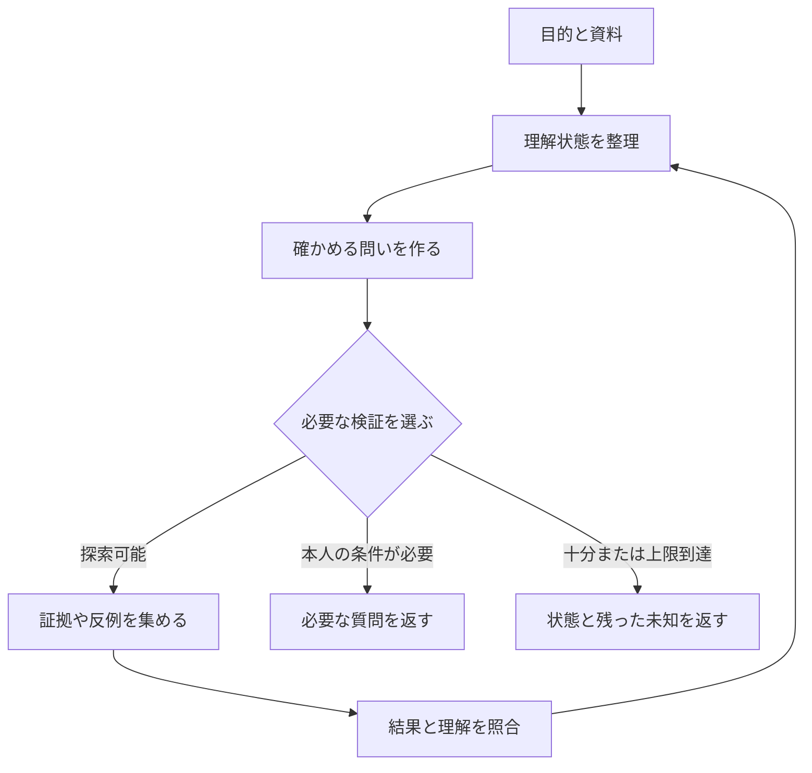

# TOMBO 仕様書

版: 0.1　作成日: 2026年10月13日　契約補足: 2026年10月14日　状態: 仕様案と探索的試作品の基準

実装済みの範囲、実際に行った検証、未実施の実モデル比較はREADME.mdを参照する。本書の公開や効果に関する目標を、実施済みの結果として扱わない。

TOMBO（トンボ）は、AIエージェントが自分の理解を点検し、未確認の前提や見えていない観点の候補を見つけ、理解を確かめるための次の探索を選ぶOSSである。質問、資料、回答案、操作予定を受け取り、根拠と未確認事項を分けて返す。新しい証拠を得た後は、何を理解し直したかを更新する。

最初の公開では、既存エージェントへ追加できるスキル、TypeScript SDK、CLI、比較実験用の小さなデータセットを提供する。本仕様に記す機能、しきい値、構成は設計上の決定であり、実装済みの能力や効果の実測値ではない。

## 1 名前と中心となる考え方

開発名称は **TOMBO**、日本語の説明は **AIが自分の理解を確かめる複眼ツール** とする。FUKUGANは別名候補として残す。トンボと複眼は構想を伝える比喩として用い、生物の機能を再現するという主張には用いない。

中心にあるのは、「今の地図には、まだ描かれていない場所があるかもしれない」と気づき、それを確かめる行動を選べることである。成功した探索経路の使用回数を増やす仕組みよりも、現在の理解が成り立つ条件と、その理解が崩れる可能性を点検する仕組みを優先する。

TOMBOという名称は既存の別分野のOSSでも使用されている。公開用のパッケージ名、リポジトリ識別子、ドメインは開発名称とは別に確定する。同名の既存プロジェクトは [nanoporetech/tombo](https://github.com/nanoporetech/tombo) を参照。

## 2 構想の出発点

ビスの構想から、次の要件を採用する。

1. AIが「何を知っているか」だけでなく、「何をまだ確かめていないか」を保持する。
2. 既存の探索経路が繰り返し成功しても、それだけでその経路を優先し続けない。
3. つながりが記録されていないことと、つながりが存在しないことを区別する。
4. 見えていない観点の候補を作り、探索で確かめる。必要なら理解の区切り方も見直す。
5. 分からなかったことを、次の探索に利用できる状態として残す。

結城浩『自分の理解に関心を持つ』の、理解を確かめる方法や理解が途切れる箇所を自分へ問い、教える側にも同じ態度を求める考えを、AIの検証手順へ読み替える。AIへの適用は本プロジェクトの設計上の解釈である。出典は提供PDFの本文5〜6ページ、PDF通算8〜9ページ。書誌と著者の公開ページ: [自分の理解に関心を持つ](https://mm.hyuki.net/n/nca5303eac345)。PDF本体はOSSへ同梱しない。

ここでいう「理解状態」は、根拠、仮説、未確認事項を外部データとして管理したものである。モデルの意識、内部表現、内的な思考過程を読み取ったものとは扱わない。

## 3 grill-meとの役割分担

比較対象はMatt Pocockの公開スキルgrill-meと、そこから呼び出されるgrillingである。grillingは計画や判断を問いの木として整理し、ユーザーとの対話で理解をそろえる。環境から取得できる事実をユーザーに聞かず調べることも指示している。参照: [grill-me](https://github.com/mattpocock/skills/blob/main/skills/productivity/grill-me/SKILL.md)、[grilling](https://github.com/mattpocock/skills/blob/main/skills/productivity/grilling/SKILL.md)。

| 比較する点 | grill-meとgrilling | TOMBOの設計 |
| --- | --- | --- |
| 中心の対象 | ユーザーの計画、判断、考え | AIが作った理解、根拠、回答案、操作予定 |
| 主な問い | この判断や計画をどう具体化するか | この理解は何に支えられ、どう確かめられるか |
| 確認の相手 | ユーザーとの対話と環境調査 | 証拠、反例、テスト、追加探索。必要ならユーザー |
| 出力 | 共有理解に向けた判断の整理 | 検証可能な未確認事項と、理解状態の変更記録 |
| 継続の単位 | 計画についての対話 | 新しい証拠が入るたびの状態更新 |

どちらも前提や曖昧さを扱える。TOMBOの独立した実装対象は、**理解を検査する項目の生成、証拠に基づく状態更新、探索後の変化の記録** とする。質問の厳しさや数で差別化しない。

連携では、grill-meが整理した目的と決定をTOMBOへ渡す。TOMBOはAI側の未検証事項を返し、取得可能な事実は探索へ、本人の希望や選択は対話へ戻す。ユーザー独自版grill-with-jevについては、その現行仕様をこの比較から推定しない。

## 4 初期版の対象と範囲

| 領域 | 最初に試す用途 | TOMBOが返す確認 |
| --- | --- | --- |
| ソフトウェア開発 | 変更計画、調査結果、実装後の報告 | 変更が前提とする条件、未確認の呼び出し元、検証が届いていないケース |
| 業務自動化 | 入力処理、通知、定期処理の実行前 | 実行条件、重複、例外、再実行の扱いに関する確認 |
| 調査とRAG | 資料からの回答案 | 裏付けがない主張、適用条件の違い、未探索の資料候補 |

初期版は既存の検索器やツールを利用する側に置く。データベース、検索エンジン、モデル学習基盤を新規に作ることは含めない。外部操作を実行する権限は呼び出し元が管理する。

すべての未知の発見、万能な自己認識、幻覚の完全防止を完了条件にしない。潜在表現を使う言語外通信、自律的な新概念の確立、多数の探索エージェントの運用は研究段階へ分ける。

## 5 基本の動作



1. 呼び出し元が、目的、現在の資料、回答案または操作予定、使えるツール、予算を渡す。
2. TOMBOが、主張、前提、適用条件、未確認事項を短く整理する。
3. 各未確認事項について、気づいた理由と、確認結果により何が変わるかを記す。
4. 反例、境界条件、資料の適用範囲などから、理解を確かめる検査を作る。
5. 呼び出し元が提案された探索を実行し、取得した証拠を返す。
6. TOMBOが結果を照合する。検査できたことと、結論を支持できたことを分ける。
7. 続ける、本人の条件を聞く、現在の範囲で終了する、予算や能力の限界で終了する、のいずれかを返す。

`inspect`は検査と計画の生成を行い、外部の検索や操作を実行しない。初期版では呼び出し元がこの循環を制御する。

## 6 理解状態として持つ情報

| 要素 | 保持するもの | 注意点 |
| --- | --- | --- |
| 目的 | 今回の到達点と、説明か操作かの区別 | AIが目的を勝手に広げない |
| 主張 | 回答案や計画が依存する短い命題 | 複数条件を束ねた命題は分ける |
| 証拠 | 取得済み資料、テスト結果、本人の明示情報 | 出典、対象、取得時点、版を保持 |
| 仮説 | 原因や関連の候補 | 候補のまま保持し、事実へ自動昇格させない |
| 未確認事項 | 何が足りず、なぜ目的に関係するか | 調べていないことを不存在としない |
| 検査 | 主張を確かめる方法と判定条件 | 実行前に成功、反証、不明の条件を定める |
| 探索の試行 | どこを、どの条件で調べたか | 検索失敗や結果なしも区別する |
| 変更履歴 | どの証拠で何が変わったか | 後で撤回や再検査ができるようにする |

主張の状態は `unverified`、`supported`、`contradicted`、`disputed` とする。`supported`は指定した対象と条件の下で証拠があることを意味する。一般的な真理の保証には使わない。

未確認事項の処理状態は `open`、`checking`、`resolved`、`blocked` とする。主張の確からしさとは別の軸である。検査が実行できても、結果が不明なら未確認事項は解決しない。

解決理由は `supported`、`refuted`、`not_applicable` のいずれかを記録する。予算終了、検索結果なし、ツール利用不可は解決理由にならない。

## 7 未確認事項の分類

| 種類 | 検出のきっかけ | 次の確認の例 |
| --- | --- | --- |
| `missing_fact` | 必要な事実を取得していない | 対象の設定、版、ログを読む |
| `ambiguous_intent` | 解釈で結果が変わり、目的が一つに定まらない | 本人の条件を一つ確認する |
| `unsupported_claim` | 命題に対応する証拠がない | 出典、テスト、適用条件を確認する |
| `conflicting_evidence` | 同じ対象と条件に対して証拠が食い違う | 時点、権限、版、対象を照合する |
| `unexplored_view` | 現在の調査が同じ種類の資料や前提へ偏る | 異なる資料群、反例、境界条件を見る |
| `capability_limit` | 必要なツール、アクセス、判断能力が不足する | 呼び出し元へ不足能力を返す |

`unexplored_view`は「そこに問題がある」という確定判定ではない。**観点の候補** として出し、検査で支持または棄却する。

候補には必ず、きっかけとなった入力中の主張や事実、目的への影響、検証方法を付ける。「ほかにも何かありそう」という理由だけでは候補を採用しない。

## 8 理解を確かめる検査

各候補に対して、次のいずれかを作る。毎回すべてを実行する必要はない。

| 検査の型 | 確かめたいこと | 例 |
| --- | --- | --- |
| 具体例 | 説明が実例へ適用できるか | 仕様を一つの入出力例へ落とす |
| 反例 | 主張が成り立たない条件を説明できるか | 一度成功した処理を再実行する |
| 境界条件 | 適用範囲の端で説明が崩れないか | 入力ゼロ件、日付境界、権限の違い |
| 依存条件 | 結論の成立に何が必要か | 呼び出し元や設定が異なる場合を読む |
| 証拠の照合 | 同じ事実を別経路で確かめられるか | 実装とテスト、説明資料と実ログを照合 |
| 説明の再構成 | 新証拠の後に説明を修正できるか | 新しいエラー条件を含めて原因候補を組み直す |

検査には、実行前の仮説、必要な能力、判定条件、結果が変える主張、終了条件を付ける。AIの流暢な説明や自己採点だけで、検査に合格したことにしない。

記録する説明は、証拠と状態変更の対応が分かる短い理由とする。詳細な内的思考過程の生成や保存を仕様に要求しない。

## 9 複眼として探索先を選ぶ規則

初期の観点は、目的と範囲、主張の裏付け、適用条件、依存関係、反例、探索の偏りを点検するための入口とする。固定チェックリストの全項目をユーザーへ投げる運用にはしない。資料や検査結果に応じて、観点の候補を追加し、不要になった候補を棄却する。

候補の採用と並び順は、初期版では次の規則で決める。

1. 目的へ影響しない候補を除外する。除外理由は短く残す。
2. 予定した判断を変え得る候補を、単なる補足より先に置く。
3. 仮説を区別できる検査を、同じ情報を再取得する検査より先に置く。
4. 同じ主張、観点、資料群を調べる候補はまとめる。
5. 目的に関係する別の観点がある場合、同じ資料群の候補だけで上限を埋めない。
6. 同程度なら費用と所要時間が小さい検査を選ぶ。

この順序は設計上のヒューリスティックであり、情報利得の実測値ではない。0〜100の見せかけの確信度や、未校正の正解確率は返さない。

過去の成功回数を優先順位へ加点しない。過去の記録は「この観点を以前調べたか」「どんな条件で解決したか」「今もその条件が成立するか」の再検査に利用する。

## 10 状態更新と探索の終了

新しい資料は、取得しただけでは主張の状態を変えない。どの主張を、どの対象と条件で、支持または反証するかを照合してから変更する。

同じURLの再取得、転載、同じ原資料に依存する説明は、独立した証拠の数として加算しない。対象、版、日時の違いで説明できる食い違いは、それぞれの適用範囲へ分ける。それでも両立しない場合に `disputed` とする。

資料の版、対象、権限、用途が変わったときは、関係する解決済み項目を `open` へ戻せる。撤回前の根拠と履歴は保持する。

### 終了時に返す判定

| 判定 | 条件 | 呼び出し元への意味 |
| --- | --- | --- |
| `ready_for_requested_step` | 目的を左右する必須の未確認事項が残っていない | 指定した範囲で次の段階へ進む材料がある |
| `needs_check` | 必要な検査が残り、実行できる | 次の検査を返す |
| `needs_user_input` | 本人の希望や取得できない本人情報が必要 | 目的に影響する質問を返す |
| `blocked` | 必須の確認が残り、能力不足または予算終了 | 未解決事項と停止理由を返す |

判定順序は、必須事項なし、残予算なし、実行可能な必須検査あり、本人への質問だけで進む、その他の順とする。任意の補足だけが残る場合は、残った未知を示して終了できる。

説明タスクでは、未確認と明示した部分回答が許容されることがある。操作タスクでは、操作を左右する必須条件が未確認のまま `ready_for_requested_step` を返さない。TOMBOの判定は外部操作の許可や承認を代行しない。

未知が残っていても予算で止まる。表示は「今回取得した証拠と検査範囲では、追加の必須確認を検出しなかった」とする。「未知がない」「完全に理解した」という表示はしない。

## 11 入出力の契約

入力では、資料本文とツールの実行能力を分ける。LLMが資料中のURLを生成しただけでは、取得済みの証拠として登録しない。各資料は呼び出し元がID、出典、本文の該当箇所を登録する。

以下はコア境界の型定義案である。実装では同じ定義から実行時の検証用スキーマを作る。型の外にある自由な状態変更を受け付けない。

```ts
type ClaimStatus =
  | "unverified" | "supported" | "contradicted" | "disputed";
type GapKind =
  | "missing_fact" | "ambiguous_intent" | "unsupported_claim"
  | "conflicting_evidence" | "unexplored_view" | "capability_limit";
type ProbeMethod =
  | "example" | "counterexample" | "boundary"
  | "dependency" | "corroboration" | "reconstruction";
type Decision =
  | "ready_for_requested_step" | "needs_check"
  | "needs_user_input" | "blocked";

interface Budget {
  maxRounds: number;
  maxModelCalls: number;
  maxToolCalls: number;
  maxElapsedMs: number;
  maxInputChars: number;
  maxOutputTokensPerCall: number;
  maxCostYen?: number;
}

interface Usage {
  rounds: number;
  modelCalls: number;
  toolCalls: number;
  elapsedMs: number;
  totalTokens: number | null;
  costYen: number | null;
}

interface Evidence {
  id: string;
  kind: "document" | "code" | "test" | "user_statement";
  locator: string; // URL、ローカルファイル位置、テスト実行IDなど
  sourceGroup: string; // 同じ原資料に依存するものをまとめる
  retrievedAt: string; // ISO 8601
  version: string | null;
  scope: string; // 対象、条件、時点を短く記す
  passage: string; // 取得した該当部分
  contentHash: string;
  validity: "current" | "withdrawn" | "superseded";
}

interface Assessment {
  claimId: string;
  evidenceIds: string[];
  verdict: "supports" | "refutes" | "inconclusive";
  scopeMatched: boolean;
  reason: string;
}

interface Claim {
  id: string;
  role: "observation" | "assumption" | "hypothesis" | "answer_claim";
  text: string;
  scope: string;
  status: ClaimStatus;
  assessments: Assessment[];
}

interface Lens {
  id: string;
  label: string;
  rationale: string;
  origin: "initial" | "proposed";
  status: "candidate" | "active" | "retired";
}

interface Gap {
  id: string;
  kind: GapKind;
  lensId: string;
  question: string;
  triggerRefs: string[]; // claim、evidence、task条件の実在ID
  whyItMatters: string;
  importance: "required" | "optional";
  claimIds: string[];
  status: "open" | "checking" | "resolved" | "blocked";
  probeIds: string[];
  resolution?: {
    reason: "supported" | "refuted" | "not_applicable";
    evidenceIds: string[];
    explanation: string;
  };
}

interface Probe {
  id: string;
  gapIds: string[];
  method: ProbeMethod;
  question: string;
  requiredCapability: string;
  sourceGroups: string[];
  successCondition: string;
  refutationCondition: string;
  inconclusiveCondition: string;
  status: "pending" | "running" | "complete" | "unavailable" | "error";
}

interface TaskPacket {
  schemaVersion: "0.1";
  taskId: string;
  goal: string;
  mode: "explain" | "execute";
  successCriteria: string[];
  evidence: Evidence[];
  proposedAnswer?: string;
  proposedActions?: string[];
  capabilities: string[];
  budget: Budget;
}

interface UnderstandingState {
  schemaVersion: "0.1";
  taskId: string;
  revision: number;
  task: TaskPacket;
  evidence: Evidence[];
  claims: Claim[];
  lenses: Lens[];
  gaps: Gap[];
  probes: Probe[];
  usage: Usage;
  decision: Decision;
  stopReason: string | null;
}

interface Observation {
  executionId: string;
  probeId: string;
  outcome: "completed" | "no_result" | "unavailable" | "error";
  evidence: Evidence[];
  toolCalls: number;
  elapsedMs: number;
  costYen: number | null;
}

interface UnderstandingChange {
  kind: "claim_changed" | "gap_changed" | "lens_changed";
  targetId: string;
  before: string;
  after: string;
  evidenceIds: string[];
  reason: string;
}

interface InspectionResult {
  state: UnderstandingState;
  changes: UnderstandingChange[];
  nextProbeIds: string[];
  userQuestions: string[];
}
```

`task`は入力の固定スナップショットであり、`state.evidence`は追加取得を含む現在の証拠集合である。IDはタスク内で一意とする。`triggerRefs`の入力条件参照は`task:goal`、`task:mode`、`task:criterion:<ゼロ始まりの番号>`とし、存在する条件だけを参照できる。`locator`の存在は情報の正しさを保証しない。短い理由で、出典の適用範囲と対象の対応を説明する。

`role`は主張の由来を示す。仮説が証拠で支持されても、もともと仮説として作った履歴を消さない。`contentHash`は`passage`のUTF-8バイト列のSHA-256とし、コアが一致を確認する。`validity`が`current`以外の資料は現在の判定に使わず、過去の評価を追うために保持する。

### SDKの操作

```ts
const first = await tombo.inspect(packet);

// 呼び出し元が、選ばれた検査を既存ツールで実施する。
const observations = await host.runProbes(
  first.state.probes.filter(p => first.nextProbeIds.includes(p.id))
);

const next = await tombo.update(first.state, observations);

// 必要な証拠や条件が変化した場合は再検査する。
const reopened = tombo.invalidate(next.state, {
  evidenceIds: ["e-policy-v1"],
  reason: "対象の資料が更新された"
});
```

`inspect`と`update`は、呼び出し元から渡された生成アダプタを用いる。`invalidate`と状態遷移の適用は決定的な処理とする。外部モデル、検索先、シェルの暗黙的な選択はしない。

`update`は観測を登録し、LLMから証拠評価と追加候補の提案を取得する。コアが参照ID、条件、予算を検証した後に状態へ適用する。モデルから状態全体の上書きJSONを受け取る方式は採用しない。

### 必ず守る条件

1. 未登録の証拠IDによる状態更新は拒否する。
2. 対象の条件が一致しない評価は、支持や反証に使用しない。
3. 同じ命題について有効な支持と反証が残れば `disputed` とする。
4. 検索結果がゼロなら `no_result` を記録し、不存在や反証へ変換しない。
5. `not_applicable`の解決にも、入力の目的、範囲、証拠に基づく理由を必須とする。
6. 未解決の必須項目が残れば `ready_for_requested_step` を返さない。
7. 同じ観測の再送で、使用量や履歴を二重に加算しない。
8. 新候補の追加時にも上限を適用し、上限で採用しなかった理由を残す。

解決済みの必須項目は、必須のまま保持する。重要度を変更する場合は、目的への影響が変わった証拠と変更理由を記録する。予算不足だけを理由に任意へ降格しない。`resolution`は`resolved`のときだけ必須とし、それ以外の状態に残さない。

構造検証で証拠の意味まで正しいと保証することはできない。証拠評価の妥当性は、別のテストと比較実験で確認する。

## 12 予算とエラー処理

初期値は、追加探索2ラウンド、モデル呼び出し合計3回、外部ツール呼び出し合計6回、経過時間120秒、入力4万8000文字、モデル1回当たり出力4000トークンとする。候補は合計最大8件、各ラウンドで選ぶ検査は最大3件とする。これらは初期の上限であり、効果や費用の実測値ではない。

最初の`inspect`がモデル1回、各ラウンドの`update`がそれぞれモデル1回を消費する。検査候補の生成と次の観点の提案を、同じ呼び出しでまとめる。モデル出力の修復も呼び出し回数に含める。

経過時間はTOMBOへの呼び出しだけでなく、ホストの検査時間を含める。ホストはツールごとの時間制限と中断を実装し、実行前に残り予算を確認する。コアだけで外部ツールの実行を停止できるとは扱わない。

金額上限を指定する場合は、生成とツールの両アダプタに、事前の費用上限見積もりと実行後の利用量の報告を要求する。上限を予約できないアダプタは `budget_accounting_unavailable` で処理を開始しない。金額上限を使わない場合も、未知の費用は `null` とし、ゼロ円と表示しない。

| 状況 | 必要な応答 |
| --- | --- |
| 必須入力の欠落や矛盾 | `invalid_input`を返し、モデルを呼ばない |
| 入力上限超過 | `input_too_large`。黙って切り詰めない |
| モデルの形式違反や存在しないID | `invalid_model_output`。不正な変更は適用しない |
| モデルやツールの失敗 | 残り予算内で同一処理の再試行は1回まで。失敗を履歴へ残す |
| 追加証拠も状態変化もない | `no_progress`で終了し、未解決事項を残す |
| 能力やアクセスの不足 | 必須項目を`blocked`にし、不足能力を返す |
| 予算の上限到達 | `budget_exhausted`で終了し、未解決事項を返す |
| 古い状態に対する更新 | `revision_conflict`。現在の状態を再取得する |

`inspect`が成立する前の入力不正は型付きエラーにする。有効な状態を一度作った後の失敗は、その状態と停止理由を返す。無効な形式を「問題なし」の結果として返さない。

## 13 履歴と記憶

初期版では、タスク単位の状態JSONと追記式のJSONLを使う。専用DBは不要とする。各イベントにはタスクID、連番、観測ID、状態の版、時刻、変更対象、根拠ID、短い変更理由を付ける。

観測にはホストが付ける `executionId` を必須とする。同じ実行結果の配送を再試行するときは同じIDを使い、実際に検査を再実行したときは別のIDを使う。同じIDで内容が違う観測は拒否する。配送の再送は利用量を二重計上せず、同じ結果になった別の実行は実際の利用量を計上する。証拠の重複排除とは別に扱う。

履歴の初期イベントには版付きの構造化状態を置く。更新イベントには検証後の構造化状態、直前の版、連番と整合性検査用ハッシュを保存し、モデルの再生成なしで状態を復元する。v0.1はデータ量が小さいため、差分形式に代えて検証済み状態のスナップショットを使う。証拠本文は履歴へ保存せず、参照とハッシュ、本文未取得の明示状態を保持する。再検証に必要な本文は許可された資料保存先から再取得する。

純粋なコアは、渡された状態の版だけを扱う。保存アダプタが `expectedRevision` と現在の履歴末尾の版を同じ排他区間で比較し、不一致なら `revision_conflict` を返す。履歴を正本とし、状態JSONは再生成できるキャッシュにする。履歴の末尾が途中で切れた場合、書込みは拒否し、完全なイベントまでの読取りと明示的な復旧を分ける。状態JSONの保存に失敗しても、履歴の確定イベントから復元できる。

標準の履歴保存は証拠の参照、ハッシュ、短い説明までとする。資料本文、プロンプト全文、鍵、個人情報を無条件で保存しない。再検証に本文が必要な場合は、呼び出し元の許可された資料保存先を利用する。参照した資料を再取得できない場合は、再検証不可として扱う。

v0.1の再開対象は同じタスクである。別のタスクへ過去の未確認事項を持ち越す機能はv0.2とする。持ち越す際は、以前の解決を現在の事実へコピーせず、条件と証拠の有効性を再検査する。

例として「再送された処理で重複を確認していなかった」という履歴は、次回の確認候補を作る材料になる。「今後すべての処理で重複確認を最優先する」という固定ルールへ自動変換しない。

## 14 組み込み方と表示

| 提供物 | v0.1で提供する内容 | 制約 |
| --- | --- | --- |
| スキル | 入力の整理、証拠IDの付与、検査、状態更新の手順 | スキルだけで検査成功を保証しない |
| SDK | 型、形式検証、予算、状態更新、履歴 | 生成アダプタを呼び出し元が提供 |
| CLI | JSON入力、JSONとMarkdown出力、履歴の再生 | 明示的に選んだアダプタのみ利用 |
| デモ | 固定の検証資料と、理解状態の変化の表示 | 再生デモと実モデルの結果を分ける |

CLIの契約例は次のとおりとする。`fixture`は固定出力による動作確認用であり、検出能力の評価には使わない。

```bash
tombo inspect --input task.json --adapter fixture --out result.json
tombo update --state state.json --observations observations.json --adapter fixture --out next.json
tombo report --state next.json --format markdown --out report.md
tombo replay --ledger events.jsonl --out restored-state.json
```

終了コードは、正常な判定結果を返した場合は0、入力・モデル形式・実行基盤のエラーは1とする。`blocked`などの意味上の判定はJSONの`decision`で扱い、機械処理と説明を混同しない。

人に見せる標準レポートは次の順とする。

1. 今回の目的と判定。
2. 証拠で確かめたこと。
3. 目的に影響する未確認事項と、その理由。
4. 次に行う検査または本人への質問。
5. 前回から理解が変わった箇所。
6. 残った未知、適用範囲、利用量。

内部の状態名や候補すべてを、そのままユーザー向けの画面へ出さない。重要な項目を少数表示し、詳細は展開して読める形にする。自動化側はJSONの完全な状態を利用できる。

初期の対応先は既存の開発エージェントとRAG呼び出し元を想定する。各製品との接続方法は実装時に現行の公式仕様を確認する。MCPサーバー、専用Web管理画面、クラウド課金機能はv0.1に含めない。

## 15 デモとして示す二つのケース

### アカウント閉鎖の架空ケース

固定の架空ヘルプ資料を用意し、最初の資料には閉鎖手順のみを入れる。ユーザー入力には「権限を持つ担当者が手順を実行したが、CLOSE 409が返った」と記す。別の資料に、そのエラーと未完了契約の関係を置く。

最初の回答案は同じ閉鎖手順を案内する。TOMBOは、手順を実行済みなのに同じ案内を繰り返していることと、エラーの意味が未確認であることをきっかけに、エラー条件を調べる検査を提案する。

検査後、固定資料でエラー条件を確かめ、手順の説明から契約状態の確認へ次の行動を更新する。実在のサービスの規則や、ビス本人の請求問題の解決策としてこの例を提示しない。

### 処理の再送がある架空コード

固定リポジトリに、同じイベントが再送される仕様と、初回だけを扱うテストを用意する。処理完了という回答案に対し、TOMBOが再送時の振る舞いを確認する必要に気づけるかを示す。

再送のテストを実行し、重複を観測した場合に、回答案の主張を修正する。すべてのコードへ再送の確認を要求しない。対照ケースには、再送が関係しない処理と、重複処理が既に検証されている処理を用意する。

デモは、最初の資料、提案された検査、取得した証拠、変更後の状態を並べる。固定再生には「再生デモ」と表示し、実モデルで検出した結果にはモデルと条件を記録する。

## 16 効果を確かめる比較実験

### 比較する条件

| 条件 | 実施内容 | 確かめたい差 |
| --- | --- | --- |
| A 通常のエージェント | 一般的な目的指示で調査と回答 | 現状との比較 |
| B 一般的な再点検 | 同じモデルに不足や反例を再点検させる | 追加の思考や呼び出しの効果 |
| C 固定チェックリスト | 固定の確認観点で再点検する | 動的な観点と検査の必要性 |
| D TOMBO | 状態、検査、証拠照合、次の探索を利用 | 本仕様全体による効果 |

主要比較はDとBとする。モデル、初期資料、使えるツール、モデル呼び出し、入出力上限、外部ツール上限をそろえる。加えて実使用の費用と遅延を記録する。使い切らなかった予算を架空の利用量として加算しない。

TOMBOの構造化プロンプトと一般的な再点検の差が大きければ、観点の追加を止める条件、履歴の利用を止める条件で追加比較する。最初から機能数を増やすより、どの部分が結果へ効いたかを調べる。

### ケースの構成

最初のデータセットは、開発、業務自動化、調査の各16件、計48件を目標とする。各領域8件を開発用、8件を評価用とし、評価用24件の正解と隠した証拠はTOMBOへ渡さない。各領域に、追加確認が不要な対照ケースを少なくとも4件含め、開発用と評価用へ2件ずつ配分する。

単純な情報欠落だけでなく、古い資料、対象の違い、同じ情報源の転載、結果なし、ツール利用不可、誤った観点の候補、本人の条件が必要なケースを含める。別の言い方にした同一ケースを、開発用と評価用へ分けて置かない。

設計用の48件では未知一般の性能を推定しない。評価するのは、あらかじめ定義した重要事項を見つけ、正しい検査へ進み、回答や操作判断を改善できたかである。

### 記録する指標

| 指標 | 定義 |
| --- | --- |
| 重要事項の検出率 | 正解側で定義した必須確認事項のうち、検査可能な候補として出せた割合 |
| 指摘の適合率 | 出した確認候補のうち、目的に関係し根拠のあるものの割合 |
| 回答または判断の成功率 | 独立した正解規則で、最終的な結果が正しかったケースの割合 |
| 改善と悪化 | 基準条件が失敗しDが成功した件数と、その逆の件数 |
| 不要確認の増加 | 対照ケースで新しく発生した質問、探索、停止の件数 |
| 誤った解決 | 必須事項を証拠なしで解決済みにした件数 |
| 検査による状態変更 | 有効な証拠による支持、反証、矛盾、再開の件数 |
| 費用と遅延 | モデル、トークン、実費、ツール利用数、経過時間 |

同じ意味の確認候補を複数出しても一件と数える。出力だけから機械的に正解と判断せず、あらかじめ作った基準で別の評価者が確認する。評価者には条件ラベルを見せない。モデル評価だけで結論を確定しない。

同じケースと条件を最低3回実行し、ばらつきも示す。ケースを対応させて比較し、反復を別々の独立ケースとして扱わない。成功率はケース単位の差と区間推定を併記する。

### 公開時の判定

v0.1は探索的な試作品として公開できる。効果をうたう条件は、DがBを同予算で上回る傾向と、不要確認や誤った解決の増加をあわせて評価することとする。小規模試験の点推定だけで一般的な優位性を宣伝しない。

差が確認できなければ、その結果も公開し、構造を簡素化する。結果を見て評価ケース、正解、予算の条件を都合よく変更しない。数値による製品の合格基準が必要になった場合は、評価用データを見る前に固定する。

## 17 実装と公開までの順序

| 段階 | 作るもの | 完了条件 |
| --- | --- | --- |
| 1 契約と固定デモ | 型、入出力スキーマ、二つの架空ケース、状態遷移 | 証拠なし昇格、結果なし、撤回、二重登録を処理できる |
| 2 最小の検査器 | スキル案、生成アダプタ、inspectとupdate | 実モデルで検査を提案し、追加証拠を照合できる |
| 3 組み込みと予算 | CLI、ホスト連携例、履歴、停止処理 | 一つの開発または調査環境で循環を実行できる |
| 4 評価と公開 | 比較実験、説明資料、再現手順、利用例 | 評価条件と結果を第三者が追える |

形式契約、状態更新、予算停止、証拠IDの参照、履歴の再生について自動テストを置く。LLMの出力には固定文の一致を要求せず、条件を満たすかで評価する。

公開物は、日本語と英語のREADME、スキル、SDK、CLI、入力例、デモ、評価データ、評価結果、制約、ライセンスとする。英語の表記はイギリス英語に統一する。実際のパッケージ名やインストールコマンドは、公開先が確定するまでは作成済みと表示しない。

実装の基本はTypeScriptで、コアをネットワークや特定モデルから分離する。第三者のコードやスキルを取り込む場合は、そのライセンスと必要な表記を確認する。配布する本文や評価資料は、自作または再配布が許されるものに限定する。

## 18 Ommatidiaへ進む条件

| 段階 | 拡張すること | 先に確認すること |
| --- | --- | --- |
| TOMBO v0.1 | 一つのタスク内での理解の検査と更新 | 一般的な再点検より結果が良くなるか |
| TOMBO v0.2 | 条件付きの未知と検査経験をタスク間で再利用 | 古い条件の持ち越しで誤りが増えないか |
| Ommatidia | 検査候補から必要な探索役を構成し、証拠を統合 | 単独探索や固定の複数役より有効な証拠が増えるか |
| 記憶と概念の研究 | 未知の接続や新しい観点の候補を保持 | 候補が検証でき、棄却や撤回もできるか |

Ommatidiaでは探索役の数や肩書ではなく、異なる証拠を得られたかを評価する。同じ原資料の転載を複数の探索役が見つけても、独立した証拠として投票しない。

新しい接続先や概念を作る研究では、候補、検査済み、棄却、撤回の状態を分ける。生成した概念を、実在する事実として資料へ混ぜない。

エージェント間の理解状態は、まずID、状態、証拠参照、検査要求を持つ構造化データで交換する。この方式と、潜在表現によって言語を介さず意味を共有する研究は区別する。

## 19 新規性についての扱い

検索、生成、自己点検を組み合わせる方式にはSelf-RAGなどの先行研究がある。Self-RAGは検索と生成の評価を反省トークンで扱う。参照: [Self-RAG論文](https://arxiv.org/abs/2310.11511)、[原実装](https://github.com/AkariAsai/self-rag)。

TOMBOの検証対象は、外付けの理解状態、理解を確かめる検査、未探索観点の候補、条件付きの状態更新を合わせた構成である。この構成を実装することと、学術的な新規性を認められることは別である。

研究発表へ進む場合は、自己点検、能動的探索、不確実性推定、タスク間記憶の関連研究と比較する。候補の件数やデモの印象を、新規性や有用性の証拠に使わない。

Jevを将来接続する場合も、検出した候補の優先順位など、狭い判断の補助へ限定する。Jevの判断を証拠や検査結果として登録しない。本仕様の作成ではJevの問いの分解を参照し、Jev APIは呼び出していない。

## 20 仕様の受入条件

次の条件を満たせば、本仕様に沿ったv0.1の試作品とする。

- 主張、証拠、仮説、未確認事項を区別して出力できる。
- 重要な候補に、入力に基づくきっかけ、目的への影響、検査方法が付く。
- 検査の支持、反証、不明の条件を実行前に記録できる。
- 新証拠の後に、理解がどこで変わったかを追える。
- 検索結果なしを不存在や解決として扱わない。
- 解決済みの項目を、条件の変更で再開できる。
- 過去の成功回数をそのまま探索の優先度に変換しない。
- 予算と進展の有無で終了し、残った未知を返せる。
- 汎用的な再点検と同予算で比較できる。
- 固定再生、実モデルの結果、実証済みの主張を区別して公開できる。

## 21 参照資料

1. 結城浩『自分の理解に関心を持つ』。提供ファイル`2020-11-11_rikai12.pdf`の本文、特にPDF通算8〜9ページを参照。書誌の公開URL: [著者の公開ページ](https://mm.hyuki.net/n/nca5303eac345)。
2. [Matt Pocock grill-me](https://github.com/mattpocock/skills/blob/main/skills/productivity/grill-me/SKILL.md)。
3. [Matt Pocock grilling](https://github.com/mattpocock/skills/blob/main/skills/productivity/grilling/SKILL.md)。
4. [Self-RAG論文](https://arxiv.org/abs/2310.11511)。
5. [Self-RAG原実装](https://github.com/AkariAsai/self-rag)。
6. [同名OSS Tombo](https://github.com/nanoporetech/tombo)。

構想の要求事項は、ビスがこの会話で提示した複眼、未知、獣道、理解の自己点検についての発言による。本仕様に書いた機能の実装、比較実験、GitHubへの公開は、次の作業にあたる。
